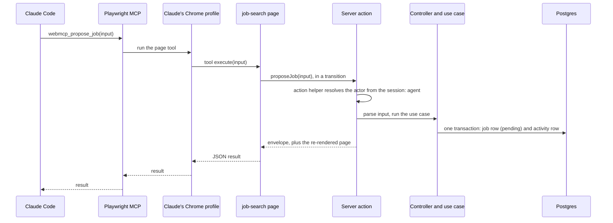
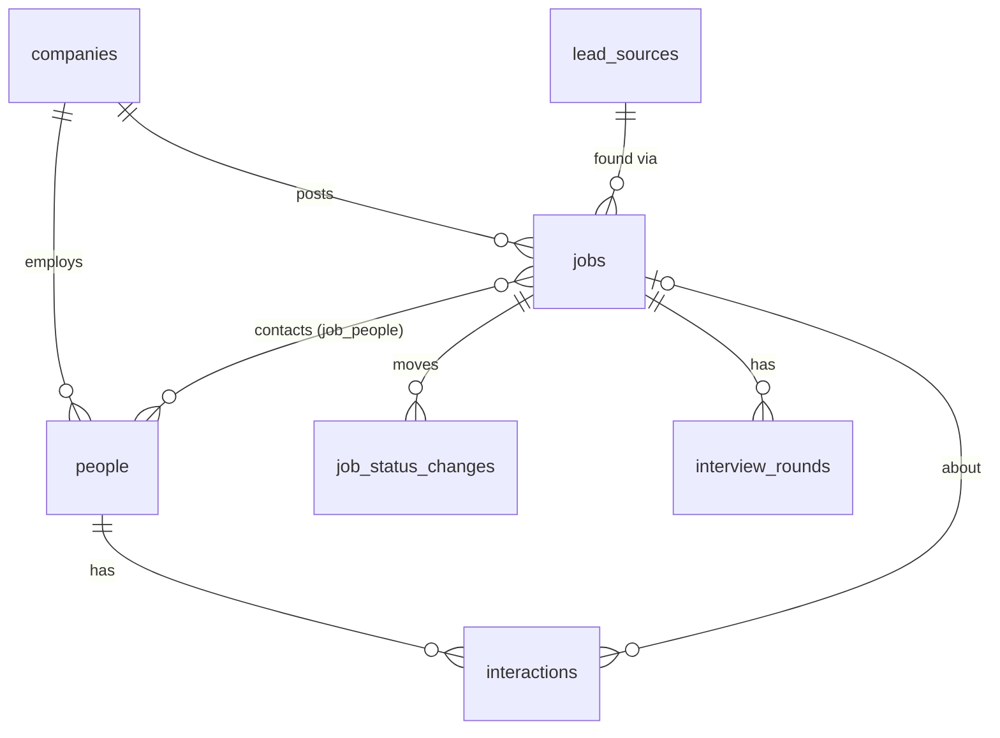
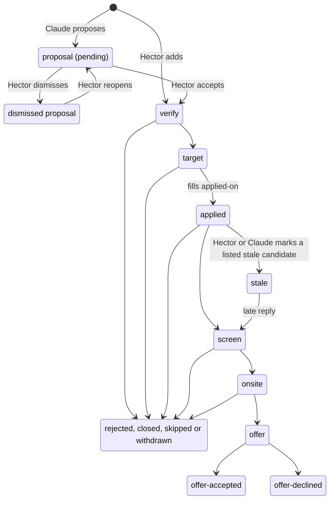
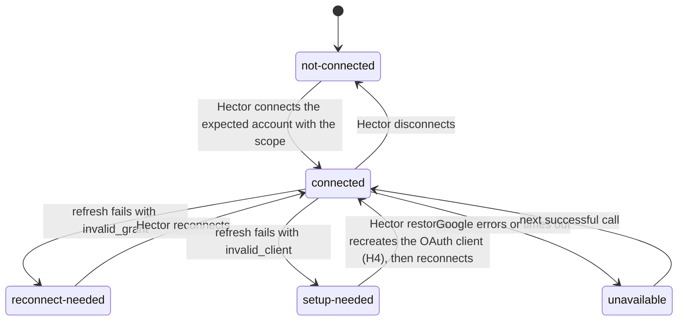

---

title: Job Search App - Plan
type: feat
date: 2026-10-23
deepened: 2026-10-23
artifact_contract: ce-unified-plan/v1
product_contract_source: ce-plan-bootstrap
execution: code
---

# Job Search App - Plan

The plan of record for building `apps/job-search`. It follows the repo's plan-doc convention ([agent-context playbook](../../../docs/development/agent-context-playbook.md#work-that-spans-sessions-the-plan-doc)): Status and How to resume first, then the plan, then Conventions, Needs from Hector and the Session log. A path that starts with `app/`, `src/`, `db/`, `di/`, `scripts/`, `tests/` or `docs/agent-access.md` is inside `apps/job-search/`; every other path is from the repo root.

---

## Status

|                   |                                                                                                                                                                                                                                                                                                                                                                                                                                                                                                                                                                                                                                                                                                                                           |
| ----------------- | ----------------------------------------------------------------------------------------------------------------------------------------------------------------------------------------------------------------------------------------------------------------------------------------------------------------------------------------------------------------------------------------------------------------------------------------------------------------------------------------------------------------------------------------------------------------------------------------------------------------------------------------------------------------------------------------------------------------------------------------- |
| Phase             | 2, Pipeline: U5 and U6 are built and reviewed on `feat/job-search-p2-pipeline` but for their page tools, which wait for U4's gate (revised 2026-10-26); Phase 2's PR is next. Phase 1: U1 to U3 and U4's local part are merged to `main` (hectarek/hector-mono#56, follow-ups hectarek/hector-mono#61). Production's deploy of f0da9b1 (hectarek/hector-mono#64) runs with its database and both account ids. U1 and U3 are done. U2 and U4's local part wait on checks that need H2 or H3 (their Evidence says which)                                                                                                                                                                                                                                 |
| Next task         | Phase 2's PR (U5 and U6, reviewed and fixed) and its Whiteboard board; the PR says production needs `0001_companies_sources_settings` and `0002_jobs_and_notes` before the merge deploys. Then a sign-in check on production (This week, and Claude's page, which reads `activity`); localhost and sign-up off on production's Neon Auth (H1's rest, H2); the test project's accounts (H2) and H3, which unblock the pending checks in U2, U4, U5 and U6, and U4's flow and spike, the gate                                                                                                                                                                                                              |
| Waiting on Hector | Phase 2's review and merge, with `0001_companies_sources_settings` and `0002_jobs_and_notes` applied to production from his terminal first (KTD17) and to the test project with his OK; whether a job keeps a tier of its own (R1) or shows its company's, as U6 built it; from Phase 2's review, whether a dismissed proposal's posting link stays fixed for his own edits too until he reopens it (Claude's are refused), and whether Accept, Dismiss and Reopen check the `updatedAt` he read, so a proposal Claude changed meanwhile isn't decided unseen (R22 names edits); localhost access and sign-up off on production's Neon Auth (H1's rest, H2), or his OK for Claude to do it: its Google sign-in is removed (2026-10-26); the test project's accounts (H2); H3 (Claude's browser: the Playwright MCP server and the permission rules). Answered 2026-10-26: U5 started before U4's gate; a record's history keeps its 50-change cap; `list_activity` is one of U5's page tools; U6 follows on the same branch, one PR for Phase 2 |
| Last updated      | 2026-10-27                                                                                                                                                                                                                                                                                                                                                                                                                                                                                                                                                                                                                                                                                                                                |

---

## How to resume

1. Read Status above, then find the first open task:

   ```bash
   grep -nE "^- \[( |~)\] \*\*U" apps/job-search/docs/build-plan.md | head -5
   ```

2. Read the root `AGENTS.md`, `apps/job-search/AGENTS.md` (from U1 on), `packages/ui/AGENTS.md` for UI work, and `docs/clean-architecture.md`.
3. Read the task's unit below, then only the KTDs and requirements it cites.
4. Check that the branch and recent commits match the Session log.
5. Before stopping, update Status, the task's state and Evidence, and add a Session log line.

---

## Task list

Tasks are this plan's units, so the tracker and the plan share IDs (see Conventions).

**Phase 1: Foundation and the agent path**
- [x] **U1** Scaffold the app — C · KTD1, KTD17, KTD19 · needs H1
- [~] **U2** Identity, access and the private screen — C · KTD2, KTD3 · needs H2
- [x] **U3** Action envelope and activity log — C · KTD4, KTD7
- [~] **U4** WebMCP adapter and the agent-path spike (gate) — C+H · KTD5, KTD6 · needs H3

**Phase 2: Pipeline**
- [~] **U5** Companies, lead sources and settings — C · KTD3
- [~] **U6** Jobs, status lifecycle and the review queue — C · KTD7, KTD8

**Phase 3: People, practice and the week**
- [ ] **U7** People, interactions and outreach logging — C · KTD9
- [ ] **U8** Practice log — C
- [ ] **U9** This week, the weekly review and fresh views — C · KTD9, KTD15
- [ ] **U10** Tool parity check and agent docs — C · KTD5, KTD16

**Phase 4: Cutover**
- [ ] **U11** Import and cutover — C+H · KTD14 · needs H5, H6

**Phase 5: Interviews and lead-source yield**
- [ ] **U12** Interview rounds and lead-source yield — C · KTD7

**Phase 6: Calendar**
- [ ] **U13** Google Calendar connection — C+H · KTD10 · needs H4
- [ ] **U14** Calendar view, scheduling and linking — C · KTD11, KTD12

**Phase 7: Profile and fit**
- [ ] **U15** Profile, fit checklist and fit notes — C · KTD13

**Phase 8: Public write-up**
- [ ] **U16** Public README and demo — C · KTD16

---

## Goal Capsule

- **Objective:** Hector runs his job search from one app instead of a spreadsheet. He and Claude both keep it current, and each day he sees what needs his decision and what is due without assembling it himself.
- **Means:** a new clean-architecture app in hector-mono that Claude works in through WebMCP page tools from its own browser profile (KTD1, KTD5, KTD6).
- **Authority:** Product Contract requirements win on behavior; KTDs win on mechanism; units override neither. The root and app `AGENTS.md` rules (never loosen a check, no write to a real database without Hector's OK at that moment, public-repo rules) override this plan.
- **Stop conditions:**
  - U4 can't get Claude Code to list and call page tools through Playwright MCP or Chrome DevTools MCP: stop all tool work and bring the agent-access decision back to Hector.
  - U13 can't keep a working refresh token: stop calendar work and raise it.
  - Any task would put a specific of the search into the repo (R24): stop and move that content to the database or Hector's private docs.
  - Any write to a real database without Hector's OK at that moment.
- **Execution profile:** Claude builds (C). Hector reviews and merges one PR per phase. Account, service and production-data steps are H or C+H (Needs from Hector).
- **Ships:** each phase deploys on merge through Vercel. The sheet retires at the end of Phase 4.

---

## Product Contract

### Summary

Build `apps/job-search`, a single-user app that replaces Hector's job-search spreadsheet. Jobs, companies, people, interactions, interviews, practice and weekly reviews live in one place, with a This week view, a week calendar backed by Google Calendar, and a profile that checks each job's fit. Claude works in it through WebMCP tools from its own signed-in browser profile; every change is attributed, and every job Claude finds waits for Hector's review. The sheet is replaced first; interviews, the calendar and the profile follow.

### Problem Frame

Hector tracks his job search in a Google Sheet with tabs for the week's numbers, jobs, people, practice and weekly reviews, and Claude keeps it current through a spreadsheet connector. The rows are flat: contacts end up as text inside a job's row, interviews and company research have no place, and nothing records where a lead came from or which sources turn into screens. Claude edits one cell at a time and has to step around formula columns, so collaborating is slow and easy to break, and the weekly numbers come from formulas that can't grow with the process.

Hector wants one place for the whole search that he and Claude both work in directly, on his laptop and his phone. Each day's decisions and due items should be assembled for him, and Claude's changes should be visible and reviewable. The app is also public code that shows how an agent can work inside an app through WebMCP, so nothing specific about the search may live in the repo.

### Actors

- A1. Hector (owner): uses the app on laptop and phone. Only he reviews proposals, deletes records, connects the calendar and changes settings.
- A2. Claude (agent identity): works through page tools in its own Chrome profile, driven from Claude Code by Playwright MCP. Proposes jobs, logs interactions, updates records and schedules meetings.
- A3. Google Calendar: holds Hector's primary calendar, which the app reads and writes.
- A4. Import script: a one-time loader Hector runs at cutover, from a snapshot Claude prepares and he reviews.

### Requirements

**Pipeline**

- R1. Hector can add, view, edit and delete jobs. A job holds the sheet's fields: company, role, status, next step and next date, applied-on date, target role, tier, level, location and work mode, posted pay band, posting link, contacts, found-on date and notes. It also holds a lead source (R5) and, for the fit checklist (R17), optional travel, employment type and team size.
- R2. A job's status is `verify`, `target`, `applied`, `screen`, `onsite` or `offer`, or a closed status: `rejected`, `closed`, `stale`, `skipped`, `withdrawn`, `offer-accepted` or `offer-declined`. Any move is allowed, and each move records the date it happened, today by default.
- R3. Status moves keep the follow-up rhythm:
  - the first move to `applied` or beyond fills an empty applied-on date with the move's date
  - a move to `applied` sets the next step "Follow up", due on applied-on + 7 days
  - a follow-up message linked to the job moves the next date to applied-on + 14 days
  - an applied job with no reply by applied-on + 21 days is listed as a stale candidate, where a reply is any move past `applied` or a reply linked to the job
  - a move to a closed status takes a reason and clears the next step and next date
- R4. Companies hold structured facts (website, location, headcount, industry, office policy, leave policy, tier) plus a short research summary and a reference to the long-form research kept in Hector's private docs. A company's page lists its jobs and people.
- R5. Every job records the lead source it came from. A sources view shows, per source and period, how many jobs were proposed, accepted, applied to, and reached `screen` or beyond.
- R6. Each job holds interview rounds with kind, time, people, prep notes, debrief notes and outcome. A round's outcome starts empty, and a round whose end time has passed with no outcome is listed for debrief; `pending` means debriefed and awaiting the employer.

**People and outreach**

- R7. Hector can add, view, edit and delete people with company, their role, how he knows them, rank A, B or C, the ask, next step and next date, and notes. Their messaged-on, replied-on and met-on dates come from logged interactions.
- R8. Interactions log sent messages, replies and conversations on a date (today by default, earlier on request), optionally linked to a job, and several sent messages can be logged in one step. A scheduled conversation ends as held, cancelled or no-show, and only held ones count as conversations.

**Daily and weekly views**

- R9. This week works on a phone and shows its sections in this order, collapsing any that are empty:
  1. decisions: proposals to review and meetings to debrief
  2. due and overdue next steps for jobs and people, stale candidates, and practice reviews due
  3. today's and tomorrow's calendar, or its connection state (R15)
  4. Claude's recent changes
  5. the week's counts against targets
- R10. Weekly counts cover messages sent, conversations held, applications (applied-on in the week), practice sessions and moves into `screen` or beyond, by Eastern-time week starting Monday. Saving a weekly review stores a snapshot of the counts and targets with the build milestone and the one change, and the view shows live counts beside a snapshot they no longer match.
- R11. A practice log records sessions (topic, date, type, pattern, AI used, minutes, result, notes) and schedules one review at a time: 2 days after a solved session, then 7 and then 21 days after each successful review, and none after the 21-day review. A failed or partial review is retried 2 days later at the same step.
- R12. Settings, which only Hector changes, hold the weekly targets and the cap on pending proposals.

**Calendar**

- R13. A week calendar shows events from Hector's primary Google calendar beside next-step dates, interview rounds, scheduled conversations and practice reviews.
- R14. Scheduling a coffee, call or interview from a record creates one event on the primary calendar, titled from the record ("Coffee: Name (Company)", "Call: Name (Company)", "Interview: Company, round"), unless an existing event such as a recruiter's invite is linked instead. The app never adds guests, never writes another calendar and changes only events it created.
- R15. When Google is disconnected, needs reconnecting or is unavailable, the calendar parts of a page say so and every other part still works.

**Profile and fit**

- R16. A read-only profile page shows target roles, skills with evidence, strengths, growth areas and constraints (locations and work modes, level range, minimum base pay, maximum travel, employment types, minimum company size, minimum team size), with when and from which version it was last synced from Hector's private docs.
- R17. Every job, proposals included, shows a fit checklist covering target role, level, location and work mode, posted band against the minimum, company size, travel, employment type and team size. Each rule shows pass, warn, fail or unknown with the inputs it used, and the job also shows Claude's written fit note.

**Working with Claude**

- R18. Claude reads and changes the tracker only through WebMCP tools the app registers, with the same validation and access checks as Hector's clicks. There is no separate API and no key.
- R19. Every change records who made it (Hector, Claude, the import or the system), the tool when one was used, and the changed fields before and after. Each record shows its history.
- R20. Jobs Claude adds wait in a review queue until Hector accepts them (status `verify`, next step "Verify it's hiring", due today) or dismisses them with a reason. A posting already on any job, dismissed ones included, is refused as a duplicate, and pending proposals stop at the cap.
- R21. The server refuses these to Claude's sign-in, whatever the entry point:
  - accepting, dismissing or reopening proposals
  - deleting anything
  - connecting or disconnecting the calendar
  - changing settings
  - the account pages and account endpoints: Claude's session can only read itself and sign out

  Claude's dated notes only append. Its fit note (R17) is replaced, with the old text kept in the activity log.
- R22. Hector's open views pick up Claude's changes when shown and at least once a minute, and an edit made against a record that changed since it was read is caught, not silently overwritten.

**Access and privacy**

- R23. Only Hector's and Claude's accounts can use the app. Any other account sees a private screen with Sign out and no data, and signed-out pages show a generic app name and the sign-in, never Hector's name.
- R24. The public repo holds no specifics of the search. Code, tests, fixtures, docs, tool descriptions, screenshots, commit messages and PR text use fictional or generic data; companies, people, targets, pay and strategy live only in the app's database or Hector's private docs.

**Cutover**

- R25. The sheet's data moves into the app once, with statuses and dates intact and contacts as people, on a week boundary after a weekly review. Afterwards the sheet is a read-only archive and no routine writes to it.

### Key Decisions

- **Public in hector-mono, with the search's specifics kept out of the repo.** (session-settled: user-directed — chosen over a private mirror of hector-mono and a standalone private repo: keeps the monorepo's shared UI, architecture and CI, with every search specific held in the database or Hector's private docs.) Governs R24.
- **Claude works only through WebMCP tools.** (session-settled: user-directed — chosen over a direct API: Claude acts inside the signed-in app with the same checks as the UI.) Governs R18.
- **Jobs Claude finds need Hector's accept.** (session-settled: user-approved — chosen over Claude adding jobs straight to the pipeline: keeps Hector's existing review rule.) Governs R20.
- **The profile is a synced, read-only view; Hector's private docs stay the source.** (session-settled: user-approved — chosen over editing the profile in the app: one source for profile facts.) Governs R16.
- **Fit comes from readable rules plus Claude's note, with no AI calls in the app.** (session-settled: user-approved — chosen over in-app AI scoring: the app makes no model calls.) Governs R17.
- **The sheet is replaced before the calendar and profile work.** (session-settled: user-approved — chosen over building everything before the switch: the sheet retires as early as possible.) Governs R25.
- **Google Calendar stays the calendar of record.** The app reads and writes Hector's primary calendar rather than keeping a calendar of its own. Governs R13, R14.

### Key Flows

- F1. Claude's daily session
  - **Trigger:** Hector starts a Claude Code session for the search.
  - **Actors:** A1, A2
  - **Steps:** Claude opens the app in its profile and calls `start_session` for the changes since its last session, then `get_today`. It asks Hector how the meetings to debrief went and records outcomes with `log_interaction`, `save_interview_round` and `set_job_status`. Research happens outside the app; finds go in with `propose_job`. Outreach drafts stay in chat; Hector sends them.
  - **Outcome:** the tracker is current and new finds wait in the queue.
  - **Covered by:** R9, R18, R19, R20, R21
- F2. Reviewing proposals on the phone
  - **Trigger:** proposals are pending.
  - **Actors:** A1
  - **Steps:** This week shows each proposal's company, role, location, level, band, fit and Claude's reason. One tap accepts or dismisses; dismissing asks for a reason from a short list.
  - **Outcome:** accepted jobs enter the pipeline with a next step; dismissed postings are blocked from coming back.
  - **Covered by:** R9, R17, R20
- F3. From a message to a counted conversation
  - **Trigger:** Hector sends an outreach message outside the app.
  - **Actors:** A1, A2, A3
  - **Steps:**
    1. The message is logged, with one tap or in a batch.
    2. A reply is logged.
    3. A coffee is scheduled onto the primary calendar, or an invite is linked.
    4. After it ends, This week lists it to debrief.
    5. Logging it as held sets met-on, and the same debrief can set the person's next step and date.
  - **Outcome:** the conversation counts in its week.
  - **Covered by:** R7, R8, R10, R14
- F4. Friday review
  - **Trigger:** the end of the week.
  - **Actors:** A1, A2
  - **Steps:** the week page or `get_week` shows counts against targets, and from Phase 5 on the sources view adds lead-source yield. Hector gives the build milestone and one change, and the review is saved with a snapshot.
  - **Outcome:** a fixed record of the week.
  - **Covered by:** R5, R10
- F5. Cutover
  - **Trigger:** Phase 3 has merged and a Friday review is done.
  - **Actors:** A1, A2, A4
  - **Steps:** freeze the sheet, export it, build and review the snapshot, dry run, import with Hector's OK, compare the week's counts, switch the routines, archive the sheet.
  - **Outcome:** the app is the only tracker.
  - **Covered by:** R25

### Acceptance Examples

- AE1. **Covers R20.** Given a dismissed job for a posting, when Claude proposes the same posting with different tracking parameters, then it gets `duplicate` with the dismissal reason and no row is created.
- AE2. **Covers R21.** Given Claude's session, when Claude clicks Accept on a proposal in its own window, then the server refuses with "Only Hector can do this", nothing changes, and the refusal appears in the activity log.
- AE3. **Covers R2, R3.** Given a job in `target`, when it moves to `applied` dated yesterday, then applied-on is yesterday, the next step is "Follow up" due 7 days after that, and 21 days after applied-on with no reply it appears as a stale candidate.
- AE4. **Covers R8, R10.** Given a server clock in UTC, when Hector logs a message at 9:30 pm Eastern on a Sunday, then it counts in the week that began the previous Monday.
- AE5. **Covers R15.** Given a revoked Google token, when This week loads, then the calendar section says to reconnect and every other section renders.
- AE6. **Covers R14.** Given a coffee scheduled from a person's page, when the request is retried after a timeout, then Google holds exactly one event, with no guests, titled "Coffee: Name (Company)".
- AE7. **Covers R23.** Given an account that is neither Hector's nor Claude's, when it signs in, then it sees a private screen with Sign out, no data loads, and no tools register.

### Success Criteria

- Hector's part of a daily session (reviewing proposals, debriefs, quick logs) takes about 10 minutes, and the Friday review about 15, from the app alone.
- After cutover nothing writes to the sheet, and the app's counts for the cutover week match the sheet's.
- Claude runs a full daily session (what's due, debriefs, logging, proposals) through page tools with no lost writes and no human-only action getting through.
- Someone reading the repo learns how the app works and nothing specific about the search: no companies, people, targets, pay or strategy.

### Scope Boundaries

**Outside this product's identity**

- AI model calls inside the app.
- Sending messages, applying, or posting anything on Hector's behalf.
- More than one owner, or sharing data with anyone.
- Claude driving LinkedIn, email or any site other than this app from its profile.
- Inviting guests to events, writing other calendars, or editing events the app didn't create.

#### Deferred to Follow-Up Work

- A live update channel (recipes' Ably pattern), for when Hector watches Claude work side by side.
- One-click undo of Claude's changes; before-values are stored from U3 on.
- Outreach drafts stored on a person, so Hector can send from his phone.
- A review queue for people Claude finds through research.
- An offer comparison scorecard.
- A public demo mode with sample data.
- A server-side MCP endpoint, if Chrome drops WebMCP or Claude needs access without a browser. It would be a second way in, so R18 would be revisited with Hector first.
- Lead sources for people, to measure which outreach channels turn into conversations.
- Extracting the Neon, Drizzle and logging infrastructure that stash, hectors-recipes and job-search share into a package.
- Importing a LinkedIn connections export.
- Merging duplicate companies and lead sources.

#### Considered and not built

- Auto-expiring proposals: the cap is the valve. Revisit if the queue fills during interview weeks.
- Marking jobs stale automatically: there is no scheduler, so stale candidates are listed and Hector or Claude marks them. Revisit if candidates pile up.
- Google push notifications (`events.watch`): one user's windowed reads are enough, and channels need a public webhook and renewal.
- A calendar library with drag and resize: an agenda covers the need (KTD12).
- An origin-trial token so everyday browsers expose tools: tools register only for Claude's identity (KTD5).
- Storing full posting text: a summary and the link limit outside text that later sessions read.
- Soft delete: deletes are human-only and logged, and Neon's point-in-time restore covers mistakes. Revisit if a delete is ever regretted.
- A server-side confirmation step for Claude's closing moves and profile replacement: both are reversible, Claude Code asks before them (KTD5), and they show in This week's list of Claude's changes.
- Vercel Skew Protection: it would pin Claude's tab to an old build and its old tool set; `reload-needed` (KTD5) is simpler.
- A go/no-go gate before each phase after cutover: it would hold back features Hector asked for, and he already starts each phase by merging the one before.

### Open Questions

None block planning. Deferred to implementation:

- Does Playwright MCP truncate tool results, and at what size? (U4)
- Does Playwright's bundled Chromium honor `--enable-features=WebMCP`, or does the config need the Chrome channel? (U4)
- Does `calendar.events.owned` return invitations on the primary calendar? (U13 spike)
- Is email verification on in the production Neon Auth project? Pinned ids (KTD2) make this non-blocking. (U2)

---

## Planning Contract

### Key Technical Decisions

- KTD1. **A new app on recipes' architecture, copied rather than shared.** `apps/job-search` follows `docs/clean-architecture.md` with `apps/hectors-recipes` as the reference. Copy its `BaseRepository`, transaction manager, `NeonAuthService`, console logger, `app/actions/shared.ts`, `app/_lib/call-action.ts`, test support and `src/entities/week.ts`. Stash and hectors-recipes already hold copies of these files, so this is the third. Extracting a package waits anyway: job-search's copies change at once (KTD3's domain error, KTD20's logging), and extraction would touch two shipped apps (Deferred to Follow-Up Work). Follow `.claude/skills/new-app/SKILL.md` plus four gaps it misses for a Neon Auth app:
  - tsconfig `declaration: false` and `declarationMap: false`
  - a `.claude/launch.json` entry: dev on 3101 and browser flows on 3301 (3100, 3201–3205 and 3300 are taken)
  - a `.fallowrc.json` `entry` for `apps/job-search/scripts/*.ts`
  - an app `.gitignore` covering `.env*`

  Recipes' Cache Components rules carry over: a page that reads the session gets its own `loading.tsx`, the clock is read after the session, and `export const dynamic` is not used. Three things deliberately differ from recipes, and the app's `AGENTS.md` records them: redirects on the tool path (KTD4), environments (KTD17) and logging (KTD20).
- KTD2. **Two pinned identities, and Hector owns every row.**
  - Sign-up is closed in each Neon project's email-and-password settings (`disable_sign_up`) once both accounts exist (H2).
  - An application-layer function maps the session's user id to an actor, with `OWNER_USER_ID` and `AGENT_USER_ID` injected per environment. Ids, not emails, as the second layer: the app can't close sign-up itself, and email verification is off at least on recipes' test project, so whoever registered an allowlisted email first would otherwise get that identity.
  - Two helpers use it. The page helper redirects anyone else to `/private`, which shows the signed-in email and Sign out. The action helper never redirects: it returns `not-allowed`, so a third account's direct POST to an action is refused before any query runs.
  - Every root table carries `owner_id`, and every repository query takes the owner id, with one PGlite test per repository proving another owner's rows stay out.
  - The auth route wraps Neon's handler so Claude's session reaches only get-session and sign-out; account endpoints such as update-user or change-email are Hector's alone. Every other route handler checks for the owner.
  - The "Claude's session" banner and the tool registrar render from a server component inside `<Suspense>`, because a layout doesn't stop its pages from rendering.
  - The auth UI hides sign-up, and both accounts are created before first use.
  - Chosen over a marked session of Hector's own user: a separate identity makes attribution and refusals server facts, keeps Claude's browser least-privileged, and needs no custom marking flow.
- KTD3. **Use cases enforce Claude's limits by actor.** Actions and route handlers pass one `{ actor, tool }` context through the controller to the use case. A `require-human.ts` helper beside the use cases, like recipes' `require-owner.ts`, checks human-only operations (R21) first: for Claude it records the refusal in its own transaction and throws `HumanOnlyError`, added to the transaction manager's `DOMAIN_ERRORS`, before the main transaction opens. Refusals are therefore logged from every entry point, and the action only maps the error. The other limits hold whatever the entry point:
  - a job created from Claude's session is always pending
  - Claude's writes to the dated notes append; its fit note is replaced instead (KTD13)
  - person dates always derive from interactions, and Claude sets applied-on only through a dated status move; Hector's edits (R1) and the import (KTD14) may set it directly

  In Claude's identity the UI shows human-only controls disabled with "Only Hector", under the banner.
- KTD4. **Every write and every tool read is a plain-argument server action that returns an envelope and never redirects.**
  - Writes follow `apps/hectors-recipes/app/actions/plan.ts` and return `{ ok: true, data, asOf }` or `{ ok: false, code, message, fields?, current? }`. Codes: `validation`, `unauthenticated`, `not-allowed`, `not-found`, `conflict`, `duplicate`, `queue-full`, `human-only`, `calendar-disconnected` (carrying the calendar state, KTD11), `reload-needed`, `unexpected`. (Revised 2026-10-23 in U3: `unexpected` added for any failure no other code covers. It's logged by class and code and answered with the action's own message.)
  - Actions call `revalidatePath`, never `redirect`, and forms navigate in the client after success. A redirect navigates the page, Chrome's `executeTool` then returns null, and Claude could not confirm the write.
  - `proxy.ts` lets requests carrying the `Next-Action` header past its signed-out redirect, so an action without a session returns `unauthenticated`. Recipes' proxy redirects them, and the redirect's HTML breaks the action client (`docs/proxy-auth-research.md`).
  - Tool reads use the same transport: one transport, one envelope mapper and one parity scan over `app/actions/*.ts` serve every tool, and R18 rules out a separate API. Each view has one controller that both its page and its read action call, and no invariant relies on the one-at-a-time dispatch Next.js uses today.
  - Chosen over GET route handlers (a second transport and error mapper, and an `/api` surface R18 excludes) and over handing page data to tools (only what the page rendered, stale between refreshes, no filters or paging). Next.js's docs aim server functions at mutations; this app accepts that for one agent working in sequence.
- KTD5. **One page-tools adapter, registered at the layout for Claude's identity only.** Instantiates the WebMCP Key Decision (session-settled: user-directed — chosen over a direct API: Claude acts inside the signed-in app with the same checks as the UI), R18.
  - `app/_lib/page-tools.ts` is the only module that touches `document.modelContext`. It is named neutrally, as recipes names its browser adapters (`live-updates.ts`), and typed by hand from the W3C draft of 20 October 2026: `registerTool(tool, { signal })`, `getTools()`, `executeTool()`. There is no `navigator.modelContext` and no `unregisterTool`; aborting the signal unregisters.
  - Tool definitions (name, description, input schema, annotations, handler) live in a plain registry module. Input schemas are the entity input schemas in `src/entities/models/`, which the controllers also parse with, converted by `z.toJSONSchema` with `io: "input"`; the lint rules bar `app/` from importing controllers.
  - One registrar in the signed-in layout registers every tool on mount and aborts on unmount, so Claude's tool list is the same whichever page its tab is on; per-page registration would also drop tools when React's `<Activity>` runs cleanups on hidden pages. It renders only for Claude's identity, decided on the server (KTD2), and only where `document.modelContext` exists; there is no polyfill. Chrome extensions can list and run page tools through content scripts, so Hector's everyday browser never exposes them.
  - Each handler calls its action inside `startTransition` through a wrapper like recipes' `app/_lib/call-action.ts`. When `unstable_isUnrecognizedActionError` from `next/navigation` matches (an action a deploy removed; checked in Next.js 16.4's types), the wrapper returns `reload-needed`: nothing ran, so Claude reloads and retries.
  - Names are snake_case and at most 30 characters, because Playwright MCP prefixes `webmcp_` and Claude Code adds `mcp__playwright__`. Descriptions stay under 500 characters and generic (R24). Results are compact and paged.
  - Annotations: `readOnlyHint` on reads; `consequentialHint` on calendar writes, `close_job` and `set_profile`; `untrustedContentHint` on reads that return outside text (KTD21). Annotations belong to a tool, not a call, so closing moves get their own `close_job` tool and `set_job_status` takes only open statuses.
- KTD6. **Playwright MCP is the bridge, and Claude gets its own Chrome profile and page.** Instantiates the WebMCP Key Decision (session-settled: user-directed — chosen over a direct API: Claude acts inside the signed-in app with the same checks as the UI), R18.
  - Playwright 1.64 exposes a page's tools to the agent as `webmcp_<tool>`, on by default, and launching Chromium with `--enable-features=WebMCP` turns the API on.
  - The Playwright MCP server is registered in the folder where search sessions start, not for every session. Its config file sets a fixed `userDataDir` (the default profile path depends on the workspace), the flag in `launchOptions.args`, and an output folder outside any repo. The profile folder sits outside iCloud and any repo, and Claude Code is denied reading it, because Playwright's Chromium keeps cookies outside the macOS keychain.
  - Hector signs Claude's account in once in that window and never signs in as himself there; Claude never types a password.
  - Claude works from a light `/agent` page (its tool list and recent activity) with no calendar section and no AutoRefresh, so the re-render after each write doesn't call Google.
  - Per-tool names let Claude Code ask before consequential tools. The same settings deny Playwright's two arbitrary-JavaScript tools (`browser_evaluate`, `browser_run_code_unsafe`), which would get around per-tool rules (System-Wide Impact).
  - A persistent profile serves one browser at a time, so one Claude session drives the app at once.
  - Fallback if U4 fails: Chrome DevTools MCP's `list_webmcp_tools` and `execute_webmcp_tool` behind `--categoryExperimentalWebmcp`. Its single generic tool means approvals need a PreToolUse hook, and its script-running tool needs the same deny.
  - Claude in Chrome and Claude's desktop browser pane can't reach page tools today: the pane's Chromium 152 has no `document.modelContext` (checked 2026-10-23), and anthropics/claude-code#76809 is open.
  - Conflict with the settled decision, workable: WebMCP is an origin trial (Chrome 149 through 162, tokens ending 30 March 2027) with no ship date, its API changed during the trial, and the agent path depends on a Chrome feature flag. KTD5's single adapter keeps a later move to a server MCP endpoint cheap.
- KTD7. **The activity log rides the write's transaction; status history has its own table.** One append-only `activity` table holds, per change:
  - the time
  - the actor: `owner`, `agent`, `import` or `system`
  - the tool name when a tool made the call, which is only a label from the page, since identity comes from the session
  - the record's kind and id, and the action
  - the changed fields with before and after values
  - an optional reason

  The use case writes it inside the same transaction as the change, as recipes requires of an access check and its write. Chosen over a Postgres audit trigger: actor and tool are application facts a trigger can't see, and the mock repositories must log the same way. Status moves also write `job_status_changes` (from, to, occurred-on date, actor), because counts and yield need the date a move happened, which can be earlier than when it was logged. Recipes' append-only `recipe_reads` table is the nearest precedent.
- KTD8. **The review queue is a review state on jobs, with dedupe and the cap enforced in the database.**
  - `review_state` is `pending`, `accepted` or `dismissed`, and repository queries default to accepted rows, pinned by a test. A proposal's status is `verify` until it is accepted. Fit and dedupe run on proposals too. Chosen over a separate proposals table: accepting is a state change on one row, not a copy.
  - Each job with a link stores a normalized `posting_key` under a partial unique index on `(owner_id, posting_key)`, and a violation maps to `duplicate`, so Hector's browser and Claude's tab can't both insert one posting. Hector's own add of a posting already on a job gets `duplicate` too, naming that job and its review state, and he accepts or reopens it from the queue. Posting links must be http(s).
  - `src/entities/posting-link.ts` builds the key with per-host rules, unit-tested per host and URL shape:
    - LinkedIn keys on the numeric job id, taken from a `/jobs/view/` path (including a slug that ends in the id) or from `currentJobId` on search pages
    - Indeed keys on the job id from `jk` or `vjk`, on any path
    - a LinkedIn or Indeed link with no job id keeps its full URL as the key
    - Greenhouse drops `gh_src`, and Workday and Lever drop the query
    - every host drops `utm_*` parameters and trailing slashes
  - A same-company, similar-title match is a soft warning only.
  - Dismiss reasons are a fixed list in `src/entities/`: `not-hiring`, `wrong-level`, `wrong-location-or-mode`, `pay-too-low`, `company-too-small`, `other`, with an optional note. A `duplicate` result returns the dismissal reason.
  - The pending cap lives in settings, 10 by default. The check runs under a per-owner `pg_advisory_xact_lock`, as recipes' daily-read cap does in `src/infrastructure/repositories/recipe-reads.repository.ts`.
- KTD9. **Interactions are dated events; person dates and weekly counts derive from them.** `interactions` holds kind (`message-sent`, `reply-received`, `conversation`), occurred-on date, an optional job link and notes. A scheduled conversation also has start and end times, an optional calendar link and a state (`scheduled`, `held`, `cancelled`, `no-show`). A person's messaged, replied and met dates are the latest matching events at read time. Counts use occurred-on dates in Eastern-time weeks keyed by Monday (`mondayOf`), never `created_at`. Chosen over the sheet's date columns on the person: the counts need every dated event, derived dates can't drift after a backfill or a delete, and deriving them is cheap for one person's records.
- KTD10. **The app runs its own Google OAuth, keyed to Hector.** Instantiates the Google Calendar Key Decision, R13, R14.
  - Authorization-code flow with PKCE, `access_type=offline` and `prompt=consent`, and scope `calendar.events.owned`, which reads and writes events on calendars Hector owns, the primary one included. The `state` is bound to Hector's session, and the connect and callback routes are owner-only.
  - The refresh token is encrypted with AES-GCM: a fresh nonce per write, the owner id and a key version as associated data, the key from env. It is keyed to the owner, so calls from Claude's session use Hector's connection.
  - After connecting, the app checks that the Google account is the one expected for that environment and that the scope was granted.
  - The OAuth client stays "In production" as an unverified personal-use app, because Testing status expires refresh tokens after 7 days.
  - Redirect URIs cover production and localhost. Localhost expects a throwaway Google account (KTD17), and preview deploys show the calendar as not connected.
  - `invalid_grant` means Hector reconnects. `invalid_client` means Google deleted the client after six idle months, which reconnecting can't fix: restore it within 30 days or redo H4. It gets its own state (KTD11).
  - Chosen over Neon Auth's `linkSocial` and `getAccessToken`, which Neon's docs don't cover. In the installed better-auth 1.6.23 that HTTP call resolves to the session's own user, so Claude's identity would look for a Google account of its own. Also chosen over a service account (a long-lived key) and the calendar's secret iCal address (read-only, hours of lag).
  - Not a bake-off: KTD11's gateway interface keeps the token source swappable.
- KTD11. **The calendar gateway: windowed reads, idempotent writes, isolated failures.**
  - `ICalendarGateway` sits in application, with Google named only on the infrastructure adapter, following recipes' vendor-naming rule.
  - The server pins the primary calendar's id; no tool or form input names a calendar. On 2026-10-23 the calendar Hector schedules on was confirmed to be the account's primary.
  - Reads: one `events.list` call on the primary calendar for the visible window per render of a page with a calendar section, expanded to single events and ordered by start. No push channels, no sync tokens.
  - In Claude's identity, tools and screens show an event the app didn't create and no record links only as its time and the organizer's email domain. Titles and locations reach Claude only for linked events and for the overlaps a slot check returns, marked `untrustedContentHint` (KTD21). This also keeps Hector's unrelated events out of agent transcripts.
  - Writes: the pending meeting row and its activity row commit first. The insert then uses the row's id without hyphens as the Google event id (Google takes 5–1024 characters from a–v and 0–9) and puts the record in `extendedProperties.private`, and a second write marks the row synced. Google may not detect an id collision at insert time, so a retry fetches that id before inserting again.
  - A repeated `schedule_meeting` call, such as Claude retrying after a timeout, first looks for a meeting row on the same record with the same start and end and reuses it: a synced row is returned as is, and a pending row is completed as above.
  - Titles are built on the server from the record. Events get no attendees, `sendUpdates: none` and `visibility: private`.
  - Only events the app created can be changed; other events are linked. A linked event outside the window is fetched by id and shown as moved or cancelled.
  - Controllers return a calendar state (`connected`, `not-connected`, `reconnect-needed`, `setup-needed`, `unavailable`), and each calendar section has its own Suspense and error boundaries, so a Google failure degrades one section.
  - Scheduling checks the slot first and returns overlapping events, so Claude can link an invite instead of duplicating it.
- KTD12. **A hand-built week agenda, no calendar library.** The calendar is a Monday-keyed week of day lists in recipes' pattern (`plan-week.tsx`, `week-swipe.tsx`, `?week=`), with `@repo/ui`'s `calendar` for jumping to a date. An event the app created, or one linked to a record, renders once, as the record's row with Google's time and a calendar mark; unlinked Google events render as plain rows. Chosen over FullCalendar 7: the design lint's restyle and arbitrary-value rules would fight its copied components, and drag or resize isn't needed. FullCalendar stays the fallback if a time grid becomes necessary.
- KTD13. **The profile is one validated document, and fit rules are pure functions over it.** Instantiates the profile and fit Key Decisions, R16, R17. `profiles` holds one Zod-validated JSON document per owner with its source version and sync time; `set_profile` replaces it whole and returns how many jobs' fit changed. Chosen over profile tables: the document is replaced whole at each sync and never queried by field. Fit rules live in `src/entities/fit.ts`, read every threshold from the profile and return each rule's result with its inputs, so public code holds the logic and the database holds Hector's values. Level, work mode and employment type are fixed value sets in `src/entities/`, with level ordered, so the profile's ranges and lists compare against the job's fields (R1). Claude's fit note is a field on the job, replaced by `set_fit_note`, with its history in the activity log.
- KTD14. **The import runs as a dry-run script over a reviewed private snapshot, and Hector runs it against production.** Claude turns the sheet export into a JSON snapshot kept in Hector's private docs, and Hector reviews it. The snapshot holds:
  - jobs with their status, next step, next date, applied-on date, and the date each job reached its current status, which Claude proposes and Hector confirms
  - contacts parsed into people, plus one dated interaction per filled date on a person (messaged-on as `message-sent`, replied-on as `reply-received`, met-on as a `held` conversation)
  - practice rows as practice entries with R11's fields
  - each job's lead source, taken from its posting link's host where that is clear and `unknown` otherwise

  `scripts/import-snapshot.ts` takes the snapshot's path as an argument, validates it with the entity schemas and writes through an import-only use case with actor `import`. That use case writes each job as the snapshot gives it: `applied` on applied-on, the current status on its confirmed date, then the snapshot's next step and next date, with none of R3's move defaults. The script:
  - reports a dry run by default, and lists any job past `applied` that lacks a date
  - commits only from Hector's terminal with his OK at that moment (`--commit`), taking the production database URL from a no-echo prompt and the production owner id as an argument, and stops unless that id exists in the target's `neon_auth.user` table
  - runs without loading `.env` (`bun --no-env-file`), so no test-project value leaks in
  - uses one transaction per record, with an `external_ref` unique index so a rerun skips what already landed

  The pattern is `apps/hectors-recipes/scripts/seed-from-obsidian.ts`. Hector, not Claude, runs the commit, so the import doesn't count as Claude changing the tracker outside page tools (R18). Chosen over importing through page tools: status writes there take today's date unless told otherwise, accepting is human-only, and the cap would stop it.
- KTD15. **Fresh views: AutoRefresh, plus patch writes with conflict checks on both sides.** Copy recipes' `app/_components/auto-refresh.tsx`, which refreshes when the page becomes visible, every 60 seconds and on reconnect. Every form and every Claude update sends only the fields it changes, with the `updatedAt` it read; a mismatch returns `conflict` with the current record. A form captures the record and its `updatedAt` when it opens and keeps both, and what Hector typed, across refreshes. On `conflict` it stays open, lists each field that changed since it opened with the current value beside his, and saves against the current `updatedAt` once he confirms. Chosen over letting Hector's patches win, which would let a stale form overwrite Claude's change (R22). Pages Hector watches during a session don't use `"use cache: private"`.
- KTD16. **Tests: recipes' harness, a fake page API, a real-browser flow and a parity check.** Use cases and repositories run on mocks and PGlite (`describeEachBackend`), controllers through `controllerBasics`, actions against the test container, and screens with Testing Library in happy-dom. Tool registration gets screen tests against a fake `document.modelContext`, plus a local Playwright flow that launches Chromium with `--enable-features=WebMCP` and drives `page.webmcp.tools()` and `callTool()` against the test project. The real-browser flow exists because a mocked API once hid a breaking move from `navigator` to `document` for months. A parity test maps every exported server action and route handler to a tool or to a human-only reason, and calls each action as a third account, expecting `not-allowed` before any query runs.
- KTD17. **Local development and previews use the test project; production secrets live only in production.**
  - Local development and preview deploys use the Neon test project with test-only secrets: database, cookie secret, ids, Google client and token key, and a throwaway Google account as the expected calendar account. Production values exist only in Vercel's Production environment. Recipes uses its production database locally; this app doesn't, because `.worktreeinclude` copies `apps/*/.env` into every worktree, and the production cookie secret plus the owner id would be enough to forge an owner session.
  - No production secret passes through a Claude session, where transcripts would keep it. Hector creates the production Neon project and enters its database URL in Vercel himself. The cookie secret and token key are generated straight into Vercel's Production environment as sensitive (write-only) variables, without being printed. Production migrations and the import's commit run in Hector's terminal through a small wrapper that reads the database URL from a no-echo prompt, never from a file left on disk. (2026-10-25: at Hector's request, `0000_activity` reached production through Neon's migration tools instead, which also keep the connection string out of the session.)
  - On the production project, Neon Auth trusts only the production domain; the test project trusts localhost and the preview wildcard. (Revised 2026-10-24: Neon accepts a wildcard only as the leftmost whole label, and a Vercel preview address is a single label under `vercel.app`. So the test project trusts each preview branch's alias exactly, added when the branch first deploys.)
  - A Vercel project rooted at the app folder, with the turbo `ignoreCommand` and the default `vercel.app` domain. (Revised 2026-10-24: Hector also gave production a custom domain. Its addresses stay out of the repo.) `noindex` through root metadata and `app/robots.ts`, and signed-out pages and metadata carry a generic name, never Hector's.
  - Browser flows run against the test project, guarded like recipes' `check-test-database`.
  - Env names, listed in the app's `turbo.json`: `DATABASE_URL`, `NEON_AUTH_BASE_URL`, `NEON_AUTH_COOKIE_SECRET`, `OWNER_USER_ID`, `AGENT_USER_ID`, `GOOGLE_OAUTH_CLIENT_ID`, `GOOGLE_OAUTH_CLIENT_SECRET`, `GOOGLE_CALENDAR_ACCOUNT_EMAIL`, `CALENDAR_TOKEN_KEY`, `LOG_LEVEL`.
- KTD18. **Eastern time everywhere.** Dates are `YYYY-MM-DD` strings end to end, and "today" comes from `todayIn` on the server for every read and write, Claude's included. Tool inputs take dates only as `YYYY-MM-DD` and times only as ISO strings with an offset. A helper beside the copied `week.ts` turns an Eastern date into UTC instants for Google's window and for "changes today", tested across the 2026-11-01 daylight-saving change. Google all-day events end on an exclusive date. One fixed zone, as recipes does: there is one user, and days spent traveling still count in Eastern time.
- KTD19. **A responsive shell, with cards on phones.** A sidebar on desktop, after `apps/hectors-tools/app/_components/app-shell.tsx`, which becomes an off-canvas sheet on phones. Lists render as a table on desktop and cards on phones, since `@repo/ui` has no data table. Chosen over recipes' bottom bar: about ten sections don't fit one, and the phone's daily work starts on This week. The cost is that Jobs and People are two taps away on a phone; recipes' bottom bar below `md` is the remedy if that matters. New primitives come through the shadcn CLI into `packages/ui`, and design-lint findings are fixed with variants and theme tokens.
- KTD20. **Logs carry error classes and codes, never field values.** Recipes' transaction manager logs `err.message`, and drizzle-orm query errors include the SQL and its parameters, so a failed write would put names, notes and pay into Vercel's logs. The copied transaction manager, repositories and actions log only the error class, the code and record ids. Google errors are scrubbed before logging, and tests assert that the logger never receives field values, tokens or secrets.
- KTD21. **Outside text stays inert.** Posting summaries, invite descriptions and notes are data, never instructions:
  - the UI renders them as plain text, and posting links must be http(s) (KTD8)
  - read tools mark them `untrustedContentHint` (KTD5), and Claude sees unlinked events the app didn't create only as times (KTD11)
  - the app stores Claude's summary of a posting with its link, not the posting's body

  Claude's damaging but reversible moves, `close_job` and `set_profile`, are consequential tools that Claude Code asks about (KTD5), and every Claude change shows in This week.

### High-Level Technical Design

An agent tool call, end to end:



Data model (`notes` and `activity` point at any record by kind and id; `profiles`, `settings` and `calendar_connections` hold one row per owner):



A job's review state and usual status moves. Any move is allowed and recorded (R2); moves to a closed status need a reason (R3):



The calendar connection's states (KTD10, KTD11):



### Output Structure

```text
apps/job-search/
  AGENTS.md, README.md, package.json, tsconfig.json, next.config.ts, proxy.ts, turbo.json, vercel.json
  docs/
    build-plan.md                  this plan
    agent-access.md                setting up Claude's browser profile (U4)
  app/
    (api)/api/auth/[...path]/      Neon Auth handler
    (api)/api/calendar/            connect and callback routes (U13)
    (auth)/                        welcome, auth/[path], private
    (main)/                        This week at /, jobs, people, companies, practice, week, calendar, sources, profile, settings, agent
    _components/                   app shell, session chrome, agent tools registrar, record history, auto refresh, quick log, cards
    _lib/                          current actor, page-tools adapter, call-action wrapper, agent-tools registry and parity map
    _providers/
    actions/                       shared envelope plus one file per domain
  src/
    entities/                      models, errors, week.ts, eastern-time.ts, job-lifecycle.ts, posting-link.ts,
                                   practice-ladder.ts, weekly-counts.ts, fit.ts, calendar-titles.ts
    application/                   repository and service interfaces, use cases by domain
    interface-adapters/controllers/
    infrastructure/                repositories (with mocks), services (Neon Auth, transactions, logger, Google OAuth, calendar gateway)
  di/                              container, types, modules
  db/                              schema.ts, index.ts, migrations/
  scripts/import-snapshot.ts       one-time import (U11)
  tests/                           _support, src, app, scripts, flows
```

### Sequencing

Each phase is one branch and PR and leaves a usable app:

1. **Foundation and the agent path** (U1–U4): a signed-in shell, the two identities, the envelope and history, and the WebMCP spike. U4 gates every later tool.
2. **Pipeline** (U5, U6): companies, sources, settings, jobs and the review queue.
3. **People, practice and the week** (U7–U10): the rest of sheet parity, This week, the weekly review and the parity check.
4. **Cutover** (U11): the sheet retires.
5. **Interviews and lead-source yield** (U12).
6. **Calendar** (U13, U14): connection first, behind its own spike.
7. **Profile and fit** (U15).
8. **Public write-up** (U16).

### Risks & Dependencies

| Risk                                                                                                                                | Handling                                                                                                                                                           |
| ----------------------------------------------------------------------------------------------------------------------------------- | ------------------------------------------------------------------------------------------------------------------------------------------------------------------ |
| WebMCP changes again or is withdrawn: origin trial through Chrome 162, no ship date                                                 | One adapter (KTD5), a real-browser flow (KTD16), a flag-enabled agent profile (KTD6); a server MCP endpoint is the deferred fallback                               |
| Playwright MCP's WebMCP support is new                                                                                              | Pin its version in the search folder's config; Chrome DevTools MCP is the fallback (KTD6)                                                                          |
| The client truncates large tool results                                                                                             | Compact, paged results (KTD5); U4 measures the limit                                                                                                               |
| A deploy changes action ids under Claude's open tab                                                                                 | `reload-needed` (KTD5); Claude reloads and retries                                                                                                                 |
| Google revokes the refresh token                                                                                                    | `reconnect-needed` (R15); Hector reconnects from Settings                                                                                                          |
| Google deletes the OAuth client after six idle months                                                                               | `setup-needed` (KTD10, KTD11): restore it within 30 days or redo H4                                                                                                |
| Production secrets reach worktrees or Claude's transcripts                                                                          | Local development and previews use the test project, and production values never pass through a Claude session (KTD17)                                             |
| Claude acts through a side door: a connector, a database or hosting tool, arbitrary JavaScript in the page, or Hector's own browser | Deny rules in the search sessions' settings (System-Wide Impact); U4 checks each one                                                                               |
| A stranger registers on the open sign-up endpoint                                                                                   | Sign-up disabled in each Neon project once both accounts exist (H2); pinned ids, the action helper's refusal and the auth-route wrapper as the second layer (KTD2) |
| A specific of the search lands in the public repo or the logs                                                                       | R24, KTD20, fictional fixtures, the PR check in the Verification Contract                                                                                          |
| Prompt injection through outside text: postings, invite descriptions, notes                                                         | KTD21                                                                                                                                                              |
| Time-zone and daylight-saving errors in counts                                                                                      | KTD18 helpers and tests around 2026-11-01                                                                                                                          |
| Cutover loses or doubles data                                                                                                       | Frozen sheet, dry run, idempotent import, sheet kept as an archive (U11)                                                                                           |
| Two Claude sessions open the agent profile                                                                                          | Playwright MCP's profile lock allows one; `docs/agent-access.md` says so                                                                                           |

### System-Wide Impact

- **Root files:** `.oxlintrc.json` (design and architecture overrides), `.fallowrc.json` (the scripts entry), `.claude/launch.json` (ports), and the root `AGENTS.md` and `README.md` (the app listed).
- **New external resources:** Neon production and test projects, a Vercel project, a Google Cloud OAuth client.
- **Hector's machine:** the Playwright MCP server and Claude's browser profile, set up for the folder where search sessions start.
- **Hector's private docs:** at cutover, the daily and weekly routines move from the spreadsheet connector to page tools.
- **Agent and tool parity:** every server action and route handler maps to a tool or a human-only reason (U10).

#### Boundaries and side doors

- **Human-only means Hector's own session.** Anything that can drive his session gets past R21 as far as the server can tell: Hector himself, and Claude in Chrome in his everyday browser. Search sessions deny Claude in Chrome on the app, and Claude's profile never holds Hector's sign-in.
- **Claude's write paths outside the app are closed with deny rules:** the calendar and file connectors' write tools (the spreadsheet connector's too, from cutover on), database and hosting MCP servers' write and env tools, and browser tools that run arbitrary JavaScript. Ask rules are advisory; deny rules are the boundary. The database connection is also kept away from the app's project.
- **Where the rules live:** the settings of the folder where search sessions start, plus Hector's user settings. The specifics stay in his private config.
- **Secrets by environment:** local development and previews hold only test-project secrets; production secrets live only in Vercel's Production environment (KTD17).
- **The combined risk:** one search session holds private data, outside text and ways to send data out. Deny the outbound tools it doesn't need, and treat record text as data (KTD21).

### Documentation and Operational Notes

- `apps/job-search/AGENTS.md`: stack, actor model, the envelope's difference from recipes, tool conventions, the human-only list, the privacy rule, and links to this plan and `docs/agent-access.md`.
- `apps/job-search/docs/agent-access.md`: the Playwright MCP config (profile and output folders, flag), signing in Claude's account and never Hector's there, the ask and deny rules in generic terms, the `/agent` page, the fallback client, one session at a time.
- `apps/job-search/README.md`: what the app does and how its agent access works, in generic terms.
- A PR with new tables, use cases, services or access rules gets a Whiteboard board, per the root `AGENTS.md`.

---

## Implementation Units

| U-ID | Title                                        | Key files                                                                                                           | Depends on                |
| ---- | -------------------------------------------- | ------------------------------------------------------------------------------------------------------------------- | ------------------------- |
| U1   | Scaffold the app                             | `apps/job-search/` config, `app/` shell, copied infrastructure; root lint, Fallow and launch config                 | none                      |
| U2   | Identity, access and the private screen      | `app/_lib/current-actor.ts`, `neon-auth.service.ts`, `(auth)/private/page.tsx`                                      | U1                        |
| U3   | Action envelope and activity log             | `app/actions/shared.ts`, `activity` table, `use-cases/activity/`                                                    | U2                        |
| U4   | WebMCP adapter and the agent-path spike      | `app/_lib/page-tools.ts`, `agent-tools/registry.ts`, `_components/agent-tools.tsx`, `(main)/agent/`, `tests/flows/` | U3                        |
| U5   | Companies, lead sources and settings         | `companies`, `lead_sources`, `settings` tables and pages                                                            | U3; U4 for its page tools |
| U6   | Jobs, status lifecycle and the review queue  | `job-lifecycle.ts`, `posting-link.ts`, `jobs`, `job_status_changes`, `notes`                                        | U5; U4 for its page tools |
| U7   | People, interactions and outreach logging    | `people`, `interactions`, `quick-log.tsx`                                                                           | U6                        |
| U8   | Practice log                                 | `practice-ladder.ts`, `practice_entries`                                                                            | U3, U4                    |
| U9   | This week, the weekly review and fresh views | `weekly-counts.ts`, `(main)/page.tsx`, `(main)/week/`, `auto-refresh.tsx`                                           | U6, U7, U8                |
| U10  | Tool parity check and agent docs             | `agent-tools/parity.ts`, parity test, app `AGENTS.md`, `docs/agent-access.md`                                       | U5–U9                     |
| U11  | Import and cutover                           | `scripts/import-snapshot.ts`, `import-snapshot.model.ts`                                                            | U9, U10                   |
| U12  | Interview rounds and lead-source yield       | `interview_rounds`, `(main)/sources/`                                                                               | U9                        |
| U13  | Google Calendar connection                   | `google-oauth.service.ts`, `calendar_connections`, `(api)/api/calendar/`                                            | U2                        |
| U14  | Calendar view, scheduling and linking        | `google-calendar.gateway.ts`, `eastern-time.ts`, `(main)/calendar/`                                                 | U12, U13                  |
| U15  | Profile, fit checklist and fit notes         | `fit.ts`, `profiles`, `(main)/profile/`                                                                             | U6, U9                    |
| U16  | Public README and demo                       | `apps/job-search/README.md`                                                                                         | U10                       |

### Phase 1: Foundation and the agent path

### U1. Scaffold the app

- **Goal:** a signed-in, empty, deployable `apps/job-search` shell, built from the new-app checklist.
- **Requirements:** R23 (sign-in plumbing), R24.
- **Dependencies:** none; the first deploy needs H1.
- **Files:**
  - Create: `apps/job-search/package.json`, `tsconfig.json`, `next.config.ts`, `components.json`, `postcss.config.mjs`, `bunfig.toml`, `turbo.json`, `vercel.json`, `drizzle.config.ts`, `.env.example`, `.gitignore`, `proxy.ts`, `AGENTS.md`, `README.md`
  - Create: `apps/job-search/app/layout.tsx`, `app/globals.css`, `app/error.tsx`, `app/not-found.tsx`, `app/robots.ts`, `app/_providers/`, `app/(api)/api/auth/[...path]/route.ts`, `app/(auth)/welcome/page.tsx`, `app/(auth)/auth/[path]/page.tsx`, `app/(main)/layout.tsx`, `app/(main)/page.tsx`, `app/(main)/loading.tsx`, `app/_components/app-shell.tsx`
  - Copy from `apps/hectors-recipes`: `lib/auth/server.ts`, `lib/logger.ts`, `db/index.ts`, `app/actions/shared.ts`, `app/_lib/call-action.ts`, `src/entities/errors/common.ts`, `src/entities/week.ts`, `src/infrastructure/repositories/base.repository.ts`, `src/infrastructure/services/` (Neon Auth, transaction manager, logger, and their mocks), `di/`, `tests/_support/`, `tests/src/entities/week.test.ts`
  - Create: `apps/job-search/db/schema.ts` (empty to start)
  - Modify: `.oxlintrc.json`, `.fallowrc.json`, `.claude/launch.json`, `AGENTS.md` (Monorepo Structure), `README.md` (apps table)
  - Tests: `apps/job-search/tests/proxy.test.ts`
- **Approach:**
  1. Follow `.claude/skills/new-app/SKILL.md` plus the gaps in KTD1, including planting one forbidden import to confirm the architecture overrides fail.
  2. Copy recipes' infrastructure and harness, keeping its Cache Components settings and changing its logging per KTD20.
  3. Build the shell per KTD19, with `noindex` and a generic name on signed-out pages (KTD17).
  4. Set up environments per KTD17: the local `.env` holds only test-project values, and production values reach Vercel's Production environment as sensitive variables without passing through a Claude session.
  5. Start from recipes' `proxy.ts`, letting requests that carry the `Next-Action` header past the signed-out redirect (KTD4).
  6. Start the app's `AGENTS.md`: stack, the three differences from recipes (KTD1), the privacy rule (R24), and a link to this plan.
- **Patterns to follow:** `apps/hectors-recipes` (layout, auth route and page, `proxy.ts`, test harness), `apps/hectors-tools/app/_components/app-shell.tsx`.
- **Test scenarios:**
  - A page request without a session cookie: redirected to the welcome page.
  - A server-action request without a session cookie: passed through, so the action returns `unauthenticated` instead of an HTML redirect.
- **Verification:**
  - Checks, build and tests pass, including `apps/job-search/tests/proxy.test.ts` and the copied `week.ts` tests.
  - The planted import fails `bun check --filter=job-search`.
  - A signed-out visit lands on the welcome page.
  - The preview deploy serves the shell marked `noindex`.
- **Evidence (2026-10-23):** commits 868bfdd and f50e1b6 on the Phase 1 branch; no PR yet.
  - Built: the app's config, the shell (a sidebar on desktop, an off-canvas sheet on phones), the welcome and auth pages, and `proxy.ts` with the `Next-Action` pass-through. Also recipes' auth, logger and transaction services with their mocks, DI, the test harness, and the root lint, Fallow, launch and README entries. Recipes' `BaseRepository` and `app/actions/shared.ts` came with U3, and `app/_lib/call-action.ts` comes with U4, because Fallow fails an unused file.
  - Checks:
    - lint and types pass, and a planted `src/entities` import of infrastructure fails `bun check` on `no-restricted-imports`
    - the build passes with placeholder env values
    - 39 tests pass, 12 of them in `tests/proxy.test.ts`
    - locally, a signed-out `GET /` gets a 307 to `/welcome`, which is titled "Job search", is marked `noindex, nofollow`, and has no horizontal scroll at 375 px in light or dark mode
    - f50e1b6 raised the welcome page's Sign in button and the sidebar trigger to 44 px (`min-h-11`)
  - Deploy check (2026-10-24), on production: previews sit behind Vercel Authentication. Production's `/` sends a signed-out visit to `/welcome` (307), which is titled "Job search" and marked `noindex, nofollow`. The first preview, of `feat/job-search-p1-gate`, built without errors.

### U2. Identity, access and the private screen

- **Goal:** only Hector's and Claude's accounts get in, and the server knows which one is acting.
- **Requirements:** R23, R21 (foundation), R24.
- **Dependencies:** U1; H1 and H2 for the real accounts.
- **Files:**
  - `apps/job-search/src/entities/models/actor.model.ts`
  - `apps/job-search/src/entities/errors/common.ts` (`NotAllowedError`, `HumanOnlyError`)
  - `apps/job-search/src/application/services/authentication.service.interface.ts`
  - `apps/job-search/src/infrastructure/services/neon-auth.service.ts` and its mock
  - `apps/job-search/src/infrastructure/services/transaction-manager.service.ts` (`DOMAIN_ERRORS`)
  - `apps/job-search/di/modules/` (allowed ids from env)
  - `apps/job-search/src/application/use-cases/access/resolve-actor.ts`
  - `apps/job-search/app/_lib/current-actor.ts` (the page helper and the action helper)
  - `apps/job-search/app/(api)/api/auth/[...path]/route.ts` (the wrapper that limits Claude's session)
  - `apps/job-search/app/_components/session-chrome.tsx` (server component: the banner and, from U4, the registrar, inside `<Suspense>`)
  - `apps/job-search/app/(main)/layout.tsx`, `apps/job-search/app/(auth)/private/page.tsx`
  - `apps/job-search/app/_providers/auth-provider.tsx` (sign-up hidden)
  - Tests: `apps/job-search/tests/src/application/use-cases/access/resolve-actor.test.ts`, `tests/src/infrastructure/services/neon-auth.service.test.ts`, `tests/app/_lib/current-actor.test.ts`, `tests/app/(api)/api/auth/route.test.ts`, `tests/app/_components/session-chrome.test.tsx`
- **Approach:** KTD2 and KTD3. The page and action helpers replace recipes' `getCurrentUserId()` throughout. Missing or malformed id env fails closed and logs once. Test environments bind fixed owner and agent ids.
- **Patterns to follow:** `apps/hectors-recipes/app/_lib/current-user.ts`, its `NeonAuthService`, and `AblyRealtimeService` for a constructor-injected dependency under test.
- **Test scenarios:**
  - Hector's session: actor `owner`, and the owner id is the session's id.
  - Claude's session: actor `agent`, and the owner id is `OWNER_USER_ID`.
  - Covers AE7. A third account: the private screen with its email and Sign out; no data query runs.
  - An account with an allowlisted email but a different id: refused.
  - `OWNER_USER_ID` unset: every session refused, one error logged.
  - Claude's identity: the layout shows the "Claude's session" banner; Hector's shows none.
  - A third account calls an action directly: `not-allowed`, and no query runs.
  - Claude's session calls the auth route's update-user path: refused. Its get-session and sign-out calls work.
  - Signed-out pages and metadata show the generic app name only.
- **Verification:** on the test project, a third account sees the private screen and signs out, and Claude's account sees the banner.
- **Evidence (2026-10-23):** commit c3ae126; no PR yet.
  - Built: the actor model and `resolveActor` on pinned ids, the page and action helpers, the private screen, Claude's banner, and the auth route's limits on Claude's session. `NeonAuthService` now throws when a session can't be read, and sign-up is hidden in the UI.
  - Checks: lint, types, dead code and a placeholder build pass. 64 tests and 5 screen tests pass, with no failures over repeated runs (`--rerun-each`).
  - Pending: the Verification on the test project, and the 375 px check in light and dark mode. Both need the test project's accounts (H2).

### U3. Action envelope and activity log

- **Goal:** every write returns an envelope and leaves an attributed history row in its own transaction.
- **Requirements:** R18, R19, R21, R22 (the conflict code).
- **Dependencies:** U2.
- **Files:**
  - `apps/job-search/app/actions/shared.ts` (envelope, codes, the result mapper, `FIELD_LABELS`)
  - `apps/job-search/src/entities/models/activity.model.ts`
  - `apps/job-search/db/schema.ts` (`activity`)
  - `apps/job-search/src/application/repositories/activity.repository.interface.ts`
  - `apps/job-search/src/infrastructure/repositories/activity.repository.ts` and its mock
  - `apps/job-search/src/application/use-cases/activity/record-change.ts`, `list-activity.use-case.ts`
  - `apps/job-search/src/application/use-cases/access/require-human.ts`
  - `apps/job-search/src/interface-adapters/controllers/activity/list-activity.controller.ts`
  - `apps/job-search/src/infrastructure/services/transaction-manager.service.ts` (logging per KTD20)
  - `apps/job-search/app/_components/record-history.tsx` (a record's history section)
  - Tests: `apps/job-search/tests/app/actions/shared.test.ts`, `tests/src/application/use-cases/activity/record-change.test.ts`, `tests/src/application/use-cases/access/require-human.test.ts`, `tests/src/infrastructure/repositories/activity.repository.test.ts`, `tests/src/infrastructure/services/logging.test.ts`, `tests/app/_components/record-history.test.tsx`
- **Approach:** the envelope and codes per KTD4, the activity row per KTD7, refusals per KTD3, logging per KTD20. `recordChange` takes the transaction, the `{ actor, tool }` context, the record, the action, the changed fields' before and after values, and a reason. The record-history section reads the list-activity use case filtered to one record, and U5, U6 and U7 mount it on company, job and person pages (R19).
- **Test scenarios:**
  - `InputParseError` maps to `validation`, with labeled fields.
  - `UnauthenticatedError` maps to `unauthenticated`, and `HumanOnlyError` to `human-only`.
  - An unexpected error is logged by class and code only, and returns the generic message.
  - A database error that carries SQL parameters reaches the logger without any field value.
  - A change and its activity row commit together; a failure after the activity write rolls both back (PGlite).
  - A human-only operation from Claude writes one `refused` activity row in its own transaction, and the main transaction never opens.
  - `list_activity` filtered by time and actor returns newest first, paged.
  - Before and after hold only the fields that changed.
  - A record's history section lists its changes newest first, with actor, tool, and before and after values.
- **Verification:** an action test shows one activity row per write, with the right actor.
- **Evidence (2026-10-23):** commit 7c7a7e3; no PR yet.
  - Built:
    - the envelope and its mapper (`app/actions/shared.ts`)
    - the append-only `activity` table
    - `recordChange`, `listActivity` with its controller, `requireHuman` and `RecordHistory`
    - KTD20 logging through `loggable()` in the transaction manager, `BaseRepository`, `toActionError` and the auth route
  - The app's errors set their own `name`, because the production build renames classes. `ConflictError` carries R22's code, and the code `unexpected` was added (KTD4, revised).
  - Checks: lint, types, dead code and a placeholder build pass, and 108 tests and 8 screen tests pass. Each test scenario above has a test. The Verification's action test, through a stand-in write action, writes one row per write with the acting session's actor.
  - Migration `0000_activity` (one table, two indexes) is on both projects: the test project's with Hector's OK, and production's at his request through Neon's migration tools, a temporary branch first (2026-10-25, Session log).
  - The history section's 375 px check comes with U5, the first page that mounts it.

### U4. WebMCP adapter and the agent-path spike (gate)

- **Goal:** Claude Code lists and calls the app's tools end to end, and the adapter becomes the only path for every later tool.
- **Requirements:** R18, R19, R23.
- **Dependencies:** U3; H2 (Claude's account) and H3 (Playwright MCP config).
- **Files:**
  - `apps/job-search/app/_lib/page-tools.ts` (adapter and the page API's type)
  - `apps/job-search/app/_lib/agent-tools/registry.ts`
  - `apps/job-search/app/_components/agent-tools.tsx` (the client registrar, rendered by U2's `session-chrome.tsx` for Claude's identity)
  - `apps/job-search/app/(main)/agent/page.tsx` (Claude's working page)
  - `apps/job-search/app/actions/session.ts`, with use cases in `src/application/use-cases/session/` and controllers
  - `apps/job-search/playwright.config.ts`, `apps/job-search/tests/flows/webmcp.flow.ts`
  - Tests: `apps/job-search/tests/app/_components/agent-tools.test.tsx`, `tests/app/_lib/page-tools.test.ts`
  - Docs: `apps/job-search/docs/agent-access.md`
- **Approach:**
  1. Build the adapter and registrar per KTD5, the `/agent` page per KTD6, and two lasting tools: `whoami` (actor, Eastern date, tool-set version) and `start_session` (records a session start and returns the changes since the previous one).
  2. Run the spike per KTD6 on localhost, then on the deployed app. It passes when:
     - the tools appear as `webmcp_*`, and a write is logged as Claude's
     - `validation`, `unauthenticated` and, after a redeploy, `reload-needed` come back as codes
     - the page doesn't navigate, and the result-size limit is known
     - a Claude Code `ask` rule fires on a tool marked consequential
     - each tool the deny rules name (System-Wide Impact) is refused in the permission mode Hector uses
  3. If Playwright MCP fails, try Chrome DevTools MCP. If both fail, stop (Goal Capsule).
  4. Write `docs/agent-access.md`: the profile and output folders, the flag, signing Claude in (never Hector), the ask and deny rules in generic terms, one session at a time.
- **Execution note:** prove the two tools in a real flag-enabled Chrome before writing any other tool.
- **Patterns to follow:** `apps/hectors-recipes/app/_lib/live-updates.ts` (one browser module per outside API), `app/_components/plan-week.tsx` (plain-argument actions in a transition).
- **Test scenarios:**
  - Claude's identity with a fake `document.modelContext`: registers exactly the registry's tools, with their annotations.
  - Hector's identity: registers nothing.
  - No `document.modelContext`: no error, nothing registered.
  - Unmount fires the abort signal; a StrictMode double mount leaves one registration.
  - A tool call returns the action's envelope unchanged; bad input returns `validation` with field errors.
  - Each tool's input schema equals the JSON Schema generated from the entity input schema its controller parses with.
  - A call to an action that a deploy removed, which Next.js reports as an unrecognized action, returns `reload-needed`.
  - Real-browser flow: Chromium with the flag lists `whoami` and `start_session` through `page.webmcp.tools()`, and `callTool` on `start_session` writes an agent activity row on the test project.
- **Verification:** in a Claude Code session, `webmcp_whoami` and `webmcp_start_session` appear and work, the activity log shows Claude's session start, and Hector can repeat the setup from `docs/agent-access.md`.
- **Evidence (2026-10-23, local part):** commit 118eb76 on the Phase 1 branch; no PR yet.
  - Built:
    - the adapter (`app/_lib/page-tools.ts`), the registry, the registrar mounted in the session chrome for Claude's session, and recipes' `call-action.ts`
    - `whoami` and `start_session`, with their actions, use cases and controllers
    - `/agent` (its sidebar item is "Claude"), `playwright.config.ts` and `tests/flows/webmcp.flow.ts`, and `docs/agent-access.md`
  - Decided in the unit:
    - A session start is an activity row (record kind `agent-session`, action `created`), with no new table. `start_session` answers with the changes from the actor's previous start to this one.
    - The wrapper answers `unexpected` with "Couldn't reach the server" when a call throws for any reason but a removed action.
    - Write actions check the page tool's name they're given (snake_case, at most 30 characters).
    - The flow first had no test-database guard. That missed KTD17's "guarded like recipes' `check-test-database`", so `scripts/check-test-database.ts` was added with H1 (2026-10-24).
  - Probed without an account, in Playwright 1.64's Chromium (Chrome for Testing 156.0.8078.4) with `--enable-features=WebMCP`:
    - `document.modelContext` exists and `navigator.modelContext` doesn't
    - `registerTool` returns a promise that rejects on a duplicate name or an aborted signal, and aborting unregisters
    - the browser doesn't check input against the schema
    - a throwing handler reaches the caller only as "invocation failed"
    - results of 50 MB pass through
    - the app's own `registerPageTools`, with the registry's real definitions, listed each tool once after a StrictMode remount, and its results round-tripped
  - Checks: lint, types, dead code and a placeholder build pass, and 137 tests and 17 screen tests pass. Every test scenario above has a test except the real-browser flow, which is written and lists in `playwright test --list`.
  - Pending:
    - the flow on the test project (H2, for Claude's test-project account in `.env`; the test project and its `activity` table exist)
    - the spike in Claude Code: the `webmcp_*` tools, the codes, ask and deny rules, and the result-size limit after the browser (H3)
    - the deployed-app run (a production deploy with the account ids, then H3)
    - `/agent` at 375 px in light and dark mode

### Phase 2: Pipeline

### U5. Companies, lead sources and settings

- **Goal:** companies with facts and a research reference, a managed list of lead sources, and Hector's settings.
- **Requirements:** R4, R5 (the source list), R12, R21, R24.
- **Dependencies:** U3; U4 for its page tools (revised 2026-10-26).
- **Files:**
  - Models: `apps/job-search/src/entities/models/company.model.ts`, `lead-source.model.ts`, `settings.model.ts`
  - Tables in `apps/job-search/db/schema.ts`; repositories and mocks in `src/application/repositories/` and `src/infrastructure/repositories/`
  - Use cases: `apps/job-search/src/application/use-cases/companies/`, `sources/`, `settings/`; controllers alongside
  - Actions: `apps/job-search/app/actions/companies.ts`, `sources.ts`, `settings.ts`
  - Pages: `apps/job-search/app/(main)/companies/page.tsx`, `companies/[id]/page.tsx`, `settings/page.tsx`
  - Tools: entries in `apps/job-search/app/_lib/agent-tools/registry.ts`
  - Tests: `apps/job-search/tests/src/application/use-cases/companies/save-company.use-case.test.ts`, `tests/src/application/use-cases/sources/add-source.use-case.test.ts`, `tests/src/application/use-cases/settings/update-settings.use-case.test.ts`, `tests/app/actions/companies.test.ts`
- **Approach:**
  - Tools: `find_companies`, `get_company`, `save_company`, `add_source`, and `list_activity` over U3's use case and controller (revised 2026-10-26). They're registered once U4's gate passes, since U4's execution note allows no other tool before it; each action is built first, with the entity schema its controller parses with, so each tool then needs only its registry entry.
  - Company names compare ignoring case and punctuation, for a soft duplicate warning. The employer of record is the company; a client name is an optional field for agency roles.
  - Sources dedupe ignoring case.
  - Settings is one row per owner: weekly targets as numbers, and the pending cap (KTD8). Writing settings is human-only (R21).
  - Deleting a company is human-only, and refused while it has jobs or people.
  - The company page mounts U3's record history, which keeps its cap of the latest 50 changes (Hector, 2026-10-26); `list_activity` pages through the rest.
- **Test scenarios:**
  - Claude saves a company with facts: created, with an activity row as Claude.
  - Saving "Acme, Inc." while "Acme Inc" exists: created, with a duplicate warning in the result.
  - Claude deletes a company: `human-only`. Hector deletes one that has jobs: refused with the reason.
  - Claude changes settings: `human-only`. Hector saves targets: stored and read back.
  - Adding source "linkedin" when "LinkedIn" exists: returns the existing source.
  - `get_company` returns the company, its accepted jobs and its people in a compact shape.
- **Verification:** the companies and settings pages work on a phone and a laptop, and the tools appear in Claude's session.
- **Evidence (2026-10-26, all but the page tools):** the commit `feat(job-search): U5 companies, lead sources and settings` on `feat/job-search-p2-pipeline`; no PR yet.
  - Built:
    - the `companies`, `lead_sources` and `settings` tables, in migration `0001_companies_sources_settings` (three tables, a name-key index on companies, a unique one on sources, and check constraints)
    - their models, repositories and mocks, use cases (find, get, save and delete a company; add and list sources; read and save the settings), controllers and DI
    - the actions `findCompanies`, `getCompany`, `saveCompany`, `deleteCompany`, `addSource`, `updateSettings`, and `listActivity` over U3's use case and controller
    - the pages: Companies (a search, a table on desktop and cards on phones, a page at a time), a company's page (facts, research, a similar-name warning, its history), the company form at `/companies/new` and `/companies/[id]/edit`, and Settings (the weekly targets and queue cap, and the lead sources), with Companies and Settings in the sidebar
  - Decided in the unit:
    - A change to a company or to the settings is made against the `updatedAt` read with it (R22), compared while the row is locked, and `conflict` answers with the record as it is now. `updated_at` keeps milliseconds and moves on at least one per update.
    - KTD15's form behavior is built with these first forms rather than waiting for U9: a form sends only the fields typed since it opened, and on a conflict stays open on the current record with the typing kept and lists what changed.
    - Company names compare by a stored key with case and punctuation dropped. The warning is `similar` in `save_company`'s and `get_company`'s answers and a notice on the company's page, and `find_companies` matches part of the key.
    - Sources compare ignoring case and runs of spaces, under a unique index per owner. `add_source` answers `{ source, created }` and logs only a new source.
    - The settings are one row per owner from the first save: a target for each weekly count (none until set) and the queue cap (10 until set). Their history is one record, kind `settings`, whose id is the owner's.
    - The company form is two pages, as recipes' forms are, since ten fields don't fit a phone's dialog; its tier is a toggle group, since a native select can't reach 44 px.
    - The client name for a role through an agency belongs on the job, so it moved to U6 with the two scenario halves below.
  - Checks: lint, types and dead code pass, and 284 tests and 48 screen tests pass. A build with placeholder values passes, every new route partly prerendered. The migration runs on PGlite under every database test, where the tables' own refusals are tested too. Each test scenario has a test except those that need the page tools, and two halves that need U6's and U7's tables, moved there: deleting a company that has jobs or people, and `get_company`'s jobs and people.
  - Pending:
    - the registry entries once U4's gate passes, with `TOOL_SET_VERSION` bumped: `find_companies` and `get_company` (read-only; `get_company` also outside text), `save_company`, `add_source`, and `list_activity` (read-only, outside text)
    - `0001_companies_sources_settings` on the test project, with Hector's OK at that moment, and on production from Hector's terminal before the merge deploys (KTD17)
    - the Verification on a phone and a laptop, and the 375 px check in light and dark mode (U3's record history with it), once the test project has accounts (H2)
  - Reviewed with U6, 2026-10-26: U6's Evidence has the findings and their fixes, U5's among them.

### U6. Jobs, status lifecycle and the review queue

- **Goal:** the pipeline: jobs with the sheet's fields, dated status moves with follow-up defaults, and proposals Hector reviews.
- **Requirements:** R1, R2, R3, R5 (a job's source), R20, R21, R22.
- **Dependencies:** U5; U4 for its page tools (revised 2026-10-26: U4's execution note holds for U6's tools as for U5's).
- **Files:**
  - `apps/job-search/src/entities/models/job.model.ts`, `job-status-change.model.ts`, `note.model.ts`
  - `apps/job-search/src/entities/job-lifecycle.ts`, `posting-link.ts`
  - `apps/job-search/db/schema.ts` (`jobs`, `job_status_changes`, `job_people`, `notes`)
  - Repositories and mocks for jobs and notes
  - Use cases: `apps/job-search/src/application/use-cases/jobs/` (propose, create, update, set status, accept, dismiss, reopen, delete) and `notes/`; controllers alongside
  - Actions: `apps/job-search/app/actions/jobs.ts`, `notes.ts`
  - Pages: `apps/job-search/app/(main)/jobs/page.tsx` (filters; a table on desktop, cards on phones), `jobs/[id]/page.tsx`, `jobs/new/page.tsx`; dismissed proposals are `jobs/page.tsx`'s `?view=dismissed` (revised 2026-10-26)
  - Tests: `apps/job-search/tests/src/entities/job-lifecycle.test.ts`, `tests/src/entities/posting-link.test.ts`, `tests/src/application/use-cases/jobs/propose-job.use-case.test.ts`, `tests/src/application/use-cases/jobs/set-job-status.use-case.test.ts`, `tests/src/application/use-cases/jobs/review-proposal.use-case.test.ts`, `tests/src/infrastructure/repositories/jobs.repository.test.ts`, `tests/app/actions/jobs.test.ts`
- **Approach:**
  1. The lifecycle rules (R2, R3) are pure functions in `job-lifecycle.ts`; every move writes `job_status_changes` with its occurred-on date (KTD7).
  2. The queue per KTD8 and R20, including the duplicate rule for Hector's own adds and the dismiss reasons.
  3. Claude's limits per KTD3: proposals only; `update_job` can't change status or review state; notes append.
  4. Tools: `find_jobs`, `get_job`, `propose_job` (link, source, reason, and optional details including R1's fit fields), `update_job` (a patch with `updatedAt`), `set_job_status` (an open status, date), `close_job` (a closed status, date, reason; KTD5), `add_note`.
  5. `get_job` returns the job, a company summary, contacts, rounds, notes, recent activity, and the fit checklist once U15 lands. Posting summaries carry `untrustedContentHint`.
  6. The job page mounts U3's record history.
  7. From U5, which has no jobs table (moved 2026-10-26): a role through an agency is the agency's, the employer of record, and the job holds the client's name in an optional field. A company that has jobs can't be deleted (U5's rule), and `get_company` lists its accepted jobs.
- **Execution note:** write `job-lifecycle.ts` and `posting-link.ts` test-first; every later count and dedupe reads them.
- **Test scenarios:**
  - Covers AE1. Proposing a link that matches a dismissed job except for extra tracking parameters: `duplicate` with its reason; no row created.
  - Proposing a new link: pending; absent from `find_jobs` and the counts; present in the queue.
  - Pending proposals at the cap: `queue-full`.
  - Hector accepts: status `verify`, next step "Verify it's hiring" due today. He dismisses with a reason: listed under dismissed. He reopens: pending again.
  - Covers AE2. Claude accepts: `human-only`, the refusal logged, nothing changed.
  - Covers AE3. `target` to `applied` dated yesterday: applied-on is yesterday; next step "Follow up" due 7 days after it.
  - A move to `applied` when applied-on is already set: applied-on is kept.
  - Applied-on + 21 days with no reply: a stale candidate. A move past `applied` removes it.
  - Claude's `close_job` without a reason: `validation`. With a reason: next step and date cleared.
  - `set_job_status` with a closed status: `validation`, pointing to `close_job`.
  - `stale` to `screen`: allowed and recorded.
  - Hector adds a posting already on a pending or dismissed job: `duplicate`, naming that job and its review state.
  - Posting links: LinkedIn `/jobs/view/123?refId=x`, `/jobs/view/engineer-at-acme-123` and `/jobs/search/?currentJobId=123` share one key, and `currentJobId=124` gets another.
  - Posting links: Indeed takes the id from `jk` or `vjk`, so two different ids stay distinct and one id on two paths matches.
  - Posting links: a LinkedIn search link with no job id keeps its full URL, so two such links stay distinct.
  - Posting links: Greenhouse drops `gh_src`, and every host drops `utm_*`.
  - A `javascript:` posting link: `validation`.
  - Two simultaneous proposals of the same posting: one row, and the other gets `duplicate`.
  - Two simultaneous proposals with one slot left under the cap: one lands, and the other gets `queue-full`.
  - Claude's `update_job` with an old `updatedAt`: `conflict`, with the current record.
  - Claude edits an existing note: `human-only`. Hector edits his note: saved.
  - Hector deletes a job: removed with its status history. Claude deletes: `human-only`.
  - From U5's scenarios (moved 2026-10-26): Hector deletes a company that has jobs: refused with the reason. `get_company` returns the company's accepted jobs in a compact shape.
- **Verification:** Hector can work the pipeline from the jobs page on laptop and phone, and Claude can propose and update jobs through tools.
- **Evidence (2026-10-26, all but the page tools):** the commit `feat(job-search): U6 jobs, status moves and the review queue` on `feat/job-search-p2-pipeline`; no PR yet.
  - Built:
    - `job-lifecycle.ts` and `posting-link.ts`, test-first
    - the `jobs`, `job_status_changes` and `notes` tables, in migration `0002_jobs_and_notes` (the posting key unique per owner where there is one, a company or source with jobs kept from deletion, a job's moves deleted with it, and check constraints)
    - models, repositories and mocks, use cases (create, for Claude's proposals and Hector's adds; update; move; review; delete; find; get; and a note's add, edit and delete), controllers, DI and actions
    - the pages: Jobs (open, closed, to review with its count, and dismissed; a table on desktop and cards on phones), a job's page (its status moves or Hector's review, its facts, summary and notes, a stale candidate's notice, its history), the job form at `/jobs/new` (the company picked first) and `/jobs/[id]/edit`, and each company's jobs on its page, with Jobs in the sidebar
  - Decided in the unit:
    - The tools wait for U4's gate, as U5's do.
    - A job names its source by name, found ignoring case or added, so Claude needs no `add_source` first, and its company by id, which Hector's form picks first.
    - A job shows its company's tier and holds none of its own, so the two can't disagree. R1 lists a tier among a job's fields: Hector's call whether a job needs its own.
    - Contacts, the `job_people` table, moved to U7, which creates people. Dismissed proposals are a view of the jobs page (`/jobs?view=dismissed`) rather than a route of their own.
    - Only an accepted job moves, and never to a date after today. Its moves list in the order they were logged, which chains them whatever their dates.
    - Notes are records of their own in the log. Hector edits and deletes any note; Claude only adds.
    - A new job takes the owner's queue lock before its duplicate and cap checks. The mock transaction manager runs one transaction at a time, as PGlite does, so the tests of two proposals at once settle the same on both backends.
    - The forms share `FormField`, `ConflictNotice` and `DeleteButton`, which replaced U5's company-only delete.
  - Checks: lint, types and dead code pass; 427 tests and 70 screen tests pass; a build with placeholder values passes, every route partly prerendered. Every test scenario has a test, the two moved from U5 included (a company that has jobs refuses deletion; `get_company` lists its accepted jobs), except those that need the page tools.
  - Reviewed 2026-10-26 with U5 (ce-code-review: correctness, project standards, testing, maintainability, security, data migration and agent-native, plus an adversarial pass run in-process, since the cross-model one couldn't start). Its 11 findings, all P2 or P3 and each confirmed by a validator, are fixed in `fix(job-search): Phase 2 review fixes`, with tests:
    - Claude can't change a dismissed proposal, so its posting stays refused until Hector reopens it. A proposal always carries its posting's link and a reason, so the add-job form refuses Claude's session.
    - A company's delete counts its proposals too, dismissed ones included, and names them by review; its page lists them under To review and Dismissed. A job's write reads its company locked, so a delete and the write settle one at a time.
    - A move to the status a job holds writes and logs nothing, and `add_note` reads its job locked, so a note can't outlive its job's delete.
    - Clearing one end of the pay band no longer counts the cleared end. A note's edit goes against the note it opened on, and Cancel drops the typing.
    - The job lists show next dates through `formatDay`, and /settings shows its history. Claude's session sees a note's Edit and Delete, and a dismissed proposal's Edit, off with "Only Hector" (`OnlyHector`).
    - `jobs.repository.test.ts` and `notes.repository.test.ts` keep another owner's rows out of every query, and pin the queue's advisory lock on PGlite and the lock-first order on both backends. They caught the jobs mock deleting another owner's status moves, now fixed.
    - The `updated_at` bump is one helper for the repositories (`nextUpdatedAt` in `base.repository.ts`) and one for the mocks.
    - Checks: lint, types and dead code pass; 463 tests and 74 screen tests pass; a build with placeholder values passes, every route partly prerendered.
    - Left for later: one envelope helper for every action, and one hook for the forms' conflict handling (two maintainability notes, in Hector's backlog). Hector's calls, in Status.
  - Pending:
    - the registry entries once U4's gate passes, with `TOOL_SET_VERSION` bumped: `find_jobs` and `get_job` (read-only, outside text), `propose_job`, `update_job`, `set_job_status`, `close_job` (consequential) and `add_note`
    - with them, from the review's agent-native pass: `list_sources` (read-only), so Claude names a source already listed rather than adding a near-miss; a note's change that names its job, so `start_session` can place it; descriptions that say what the schemas can't (`find_jobs` reads accepted jobs by default, where `updatedAt` comes from, dates are Eastern and default to today, what a move sets, `update_job` refusing applied-on from Claude, `save_company` creating despite a similar name); labels for `id` and `updatedAt`; and `queue-full` naming the cap. U10's parity map then maps `addJob` to `propose_job` and checks the pages' own reads too.
    - `0002_jobs_and_notes`, after `0001_companies_sources_settings`, on the test project with Hector's OK at that moment, and on production from Hector's terminal before the merge deploys (KTD17)
    - the Verification on a phone and a laptop, and the 375 px check in light and dark mode, once the test project has accounts (H2)

### Phase 3: People, practice and the week

### U7. People, interactions and outreach logging

- **Goal:** contacts, and the dated outreach log that drives the weekly counts.
- **Requirements:** R7, R8, R3 (follow-up and reply rules), R21.
- **Dependencies:** U6.
- **Files:**
  - Models: `apps/job-search/src/entities/models/person.model.ts`, `interaction.model.ts`
  - Tables in `apps/job-search/db/schema.ts`; repositories and mocks
  - Use cases: `apps/job-search/src/application/use-cases/people/`, `interactions/`; controllers alongside
  - Actions: `apps/job-search/app/actions/people.ts`, `interactions.ts`
  - Pages: `apps/job-search/app/(main)/people/page.tsx`, `people/[id]/page.tsx`
  - `apps/job-search/app/_components/quick-log.tsx` (a phone sheet: sent, reply, conversation, batch sent)
  - Tests: `apps/job-search/tests/src/application/use-cases/interactions/log-interaction.use-case.test.ts`, `tests/src/application/use-cases/people/get-person.use-case.test.ts`, `tests/app/actions/interactions.test.ts`, `tests/app/_components/quick-log.test.tsx`
- **Approach:**
  - KTD9. Tools: `find_people`, `get_person`, `add_person`, `update_person`, `log_interaction` (single or batch).
  - A message linked to an applied job advances its follow-up (R3); a reply linked to a job counts as that job's reply for the stale rule.
  - The quick-log sheet opens with the person preselected from a person's page or a person row in the due list, and from a "+" on This week and People, where the person is picked by search. Fields: kind, date (today), optional job (preselected from a job page), optional note, optional next step and next date. Batch mode picks several people for one kind, date and job. A search with no match offers "Add person", asking only for name and company.
  - The person page mounts U3's record history. Deleting a person or an interaction is human-only.
  - From U5 (moved 2026-10-26): a company that has people can't be deleted, and `get_company` lists its people.
  - From U6 (moved 2026-10-26): a job's contacts (R1), the `job_people` table, which needs people; `get_job` lists them.
- **Test scenarios:**
  - A message dated last Tuesday: messaged-on is last Tuesday. A later message: the latest wins.
  - Hector deletes the latest interaction: the derived date falls back to the one before.
  - Batch sent to three people: three events and three activity rows from one action.
  - Covers AE4. A message logged at 9:30 pm Eastern on a Sunday, when the server's UTC date is Monday: counts in the week that began the previous Monday.
  - A scheduled conversation marked held: met-on set, debrief cleared, counted. Cancelled or no-show: not counted, debrief cleared.
  - A message linked to an applied job: next date moves to applied-on + 14.
  - A reply linked to an applied job: no longer a stale candidate.
  - `update_person` patches only the fields sent, and its schema has no field for the derived dates.
  - From U5's scenarios (moved 2026-10-26): Hector deletes a company that has people: refused with the reason. `get_company` returns the company's people in a compact shape.
- **Verification:** on a phone, logging a sent message or a held conversation takes one sheet and one tap to save.

### U8. Practice log

- **Goal:** practice sessions and their spaced reviews.
- **Requirements:** R11.
- **Dependencies:** U3, U4.
- **Files:** `apps/job-search/src/entities/models/practice-entry.model.ts`, `apps/job-search/src/entities/practice-ladder.ts`, the `practice_entries` table, repository and mock, use cases in `src/application/use-cases/practice/`, a controller, `apps/job-search/app/actions/practice.ts`, `apps/job-search/app/(main)/practice/page.tsx`. Tests: `apps/job-search/tests/src/entities/practice-ladder.test.ts`, `tests/src/application/use-cases/practice/log-practice.use-case.test.ts`.
- **Approach:** the ladder (R11) is a set of pure functions; a partial result counts as failed for scheduling. Tools: `list_practice` (due reviews and recent sessions) and `log_practice` (a session or a review).
- **Test scenarios:**
  - A solved session on day D: next review on D + 2. A successful review: next one 7 days after it, then 21, then none.
  - A failed or partial review: retried 2 days later at the same step.
  - Due reviews are listed in order by Eastern date.
- **Verification:** due reviews show on the practice page and, from U9 on, in This week.

### U9. This week, the weekly review and fresh views

- **Goal:** the daily landing view and the Friday review, replacing the sheet's This week and Weekly tabs, kept fresh while Claude works.
- **Requirements:** R9, R10, R20 (the queue's UI), R22.
- **Dependencies:** U6, U7, U8.
- **Files:**
  - `apps/job-search/src/entities/weekly-counts.ts`, `src/entities/models/weekly-review.model.ts`, the `weekly_reviews` table
  - Use cases: get today, get week, save weekly review, list proposals; controllers alongside
  - `apps/job-search/app/actions/week.ts`
  - Pages: `apps/job-search/app/(main)/page.tsx` (This week), `app/(main)/week/page.tsx` (`?week=`)
  - Components: `apps/job-search/app/_components/proposal-card.tsx`, `debrief-card.tsx`, `due-list.tsx`, `week-counts.tsx`, `auto-refresh.tsx` (copied)
  - Tests: `apps/job-search/tests/src/entities/weekly-counts.test.ts`, `tests/src/application/use-cases/week/get-today.use-case.test.ts`, `tests/src/application/use-cases/week/save-weekly-review.use-case.test.ts`, `tests/app/_components/proposal-card.test.tsx`, `tests/app/_components/auto-refresh.test.tsx`
- **Approach:**
  - Sections and collapse per R9, counts per R10 and KTD9, a snapshot on save. Freshness per KTD15.
  - Tools: `get_today`, `get_week`, `save_weekly_review`, `list_proposals`, and `list_activity` over U3's use case. `get_today` returns compact sections with counts and paging.
  - Each row type has one tap path:
    - a due or overdue row opens a next-step sheet for that record (change the step, change the date, clear it), and a person row also offers "Log sent"
    - a conversation debrief offers held, cancelled or no-show, notes, and an optional next step and date
    - a round debrief offers an outcome and debrief notes
    - a stale candidate offers "Mark stale" (the reason prefilled as no reply after 21 days) and "Open job"
    - a proposal's Accept is one tap, and Dismiss opens the reason list from KTD8
  - Claude's recent changes show Claude's sessions from the last 7 days, newest first, one line per session with counts by kind. Closing moves, profile replacements and refused attempts are listed individually under their session, and each session links to its full list on `/agent`.
  - The week page with no saved review shows live counts and an empty form. After saving, its counts and targets are fixed, and the form edits only the build milestone and the one change.
- **Test scenarios:**
  - A next date equal to today in Eastern time is due; an earlier one is overdue. At 11:30 pm Eastern the lists match the screen, though the server runs in UTC.
  - Each count over a fixture week matches its definition, and an interview round never counts as a conversation.
  - Save a review, then log a late message for that week: the snapshot is unchanged, the live count is higher, and both show.
  - Change a target mid-week: the current week uses the new target; saved weeks keep their snapshot.
  - Claude's `save_weekly_review`: saved as Claude's. Claude changes targets: `human-only`.
  - Screen test: Accept is one tap. Dismiss is a tap and then a tap on a reason. Either way the card leaves the section.
  - Screen test: each due, debrief and stale row opens its sheet, and saving clears or moves the row.
  - Hector saves a form he opened before Claude changed the same record, with an AutoRefresh in between: `conflict`, his typed values kept, and the form shows Claude's change beside them.
  - AutoRefresh refreshes the page when it becomes visible.
- **Verification:** a Friday review runs from the week page alone, and This week on a phone shows decisions first.

### U10. Tool parity check and agent docs

- **Goal:** CI keeps every server action mapped to a tool or to a human-only reason, and the docs explain the agent surface.
- **Requirements:** R18, R21, R24.
- **Dependencies:** U5, U6, U7, U8, U9.
- **Files:** `apps/job-search/app/_lib/agent-tools/parity.ts`, `apps/job-search/tests/app/agent-tools-parity.test.ts`, `apps/job-search/AGENTS.md` (tool conventions, the human-only list), `apps/job-search/docs/agent-access.md`.
- **Approach:** per KTD16, the test reads the exported actions in `app/actions/*.ts` and the route handlers under `app/(api)/`, and checks each against the parity map; human-only entries carry a reason. It also checks tool names, description lengths and generated schemas, and calls every action as a third account. Tool descriptions stay generic (R24).
- **Test scenarios:**
  - A new exported action with no map entry: the test fails and names it.
  - A route handler missing from the map: fails.
  - Any action called as a third account: `not-allowed`, and no query runs.
  - A human-only action that also has a tool: fails.
  - A tool name over 30 characters or a description over 500: fails.
- **Verification:**
  - CI runs the parity test, and the app's `AGENTS.md` lists every tool and every human-only action.
  - A dry run of Claude's daily session on the test project, judged by outcomes:
    - its due and debrief lists match `get_today`
    - outcomes land through `log_interaction`, `set_job_status` and `add_note`, with Claude as the actor
    - proposals stay under the cap
    - no human-only action succeeds

### Phase 4: Cutover

### U11. Import and cutover

- **Goal:** the sheet's data lands in the app once with its dates intact, and the sheet retires.
- **Requirements:** R25, R24.
- **Dependencies:** U9, U10; H5, H6.
- **Files:** `apps/job-search/scripts/import-snapshot.ts`, `apps/job-search/src/entities/models/import-snapshot.model.ts`, `apps/job-search/tests/scripts/import-snapshot.test.ts`, `.fallowrc.json`. The snapshot, the cutover runbook and the rewritten daily and weekly routines live in Hector's private docs, never in the repo.
- **Approach:** KTD14. The private runbook follows F5 and runs on a week boundary after a Friday review:
  1. Freeze the sheet.
  2. Export it; Claude builds the snapshot, and Hector reviews it and confirms each job's status date.
  3. Claude dry-runs against the test project. Hector then dry-runs and commits against production from his own terminal (KTD14, KTD17).
  4. Compare the week's counts with the sheet.
  5. Switch the routines to page tools, and deny the spreadsheet connector's writes for this work.
  6. Archive the sheet read-only.
- **Test scenarios:**
  - A dry run on a fictional snapshot reports creates and skips and writes nothing.
  - Two commit runs: the second skips every record by external ref.
  - A record with an unknown status is reported, and the other records still import.
  - Imported jobs keep applied-on and their dated status history, and their activity rows carry actor `import`.
  - An imported `applied` job keeps the snapshot's next step and next date, not R3's follow-up default.
  - An imported `screen` job counts in the week of its confirmed status date, not the import's week.
  - A job past `applied` with no status date: the dry run lists it, and the commit refuses to start.
  - Contacts in the snapshot become people linked to their jobs, with one dated interaction per filled date.
  - For a fictional snapshot, the cutover week's message, conversation and practice counts equal the snapshot's own.
  - A commit with an owner id that isn't in the target's users: stops before any write.
- **Verification:**
  - After the commit run, the app's counts for the cutover week match the sheet's, and no routine references the sheet.
  - In the first week after cutover, Hector's part of a daily session takes about 10 minutes; if it takes longer, the Session log records what slowed it.

### Phase 5: Interviews and lead-source yield

### U12. Interview rounds and lead-source yield

- **Goal:** rounds on each job, and a view of which sources are worth the search time.
- **Requirements:** R6, R5.
- **Dependencies:** U9.
- **Files:** `apps/job-search/src/entities/models/interview-round.model.ts`, the `interview_rounds` table, repository and mock, use cases in `src/application/use-cases/interviews/` and `sources/`, controllers, `apps/job-search/app/actions/interviews.ts`, the rounds section on `app/(main)/jobs/[id]/page.tsx`, `apps/job-search/app/(main)/sources/page.tsx`. Tests: `apps/job-search/tests/src/application/use-cases/interviews/save-interview-round.use-case.test.ts`, `tests/src/application/use-cases/sources/get-source-yield.use-case.test.ts`.
- **Approach:**
  - A round has a kind, start and end times, people, prep notes, debrief notes and an outcome.
  - Kinds: recruiter screen, hiring manager, technical, system design, behavioral, take-home, onsite, final, other. Outcomes: `pending`, `passed`, `rejected`, `withdrew`. The outcome starts empty, and saving any outcome, `pending` included, ends the debrief (R6).
  - Yield counts come from `job_status_changes` and review states (KTD7, KTD8).
  - Tools: `save_interview_round` and `get_sources`. Deleting a round is human-only (R21).
- **Test scenarios:**
  - A round with a time appears among upcoming items, then as a debrief once its end passes; recording any outcome, `pending` included, clears the debrief.
  - Rounds never count as conversations.
  - For a fixture period, a source's yield counts proposed and accepted jobs separately, plus jobs applied to and jobs that reached `screen` or beyond; a dismissed proposal counts only as proposed.
- **Verification:** the sources page answers "which sources lead to screens" for a chosen period.

### Phase 6: Calendar

### U13. Google Calendar connection

- **Goal:** Hector connects his Google account once, and the server can call the Calendar API from either identity's session.
- **Requirements:** R13, R15, R21.
- **Dependencies:** U2; H4.
- **Files:** `apps/job-search/src/application/services/calendar-connection.service.interface.ts`, `apps/job-search/src/infrastructure/services/google-oauth.service.ts` and a fake, the `calendar_connections` table, `apps/job-search/app/(api)/api/calendar/connect/route.ts`, `apps/job-search/app/(api)/api/calendar/callback/route.ts`, connect and disconnect on `app/(main)/settings/page.tsx`. Tests: `apps/job-search/tests/src/infrastructure/services/google-oauth.service.test.ts`, `tests/app/(api)/api/calendar/callback.test.ts`.
- **Approach:** KTD10. Start with a localhost spike against the throwaway Google account (KTD17): connect, refresh after the access token expires, revoke access to see `invalid_grant`, refuse the scope to see the check, and try the wrong account. Connect and disconnect are owner-only routes (KTD2), and logging follows KTD20.
- **Execution note:** spike connect and refresh against the real Google client before building the gateway.
- **Test scenarios:**
  - A callback with a valid code and matching state: the token is stored encrypted and the connection is `connected`.
  - A mismatched `state`: rejected.
  - A different Google account: refused, nothing stored.
  - The scope not granted: `not-connected`, with a message.
  - A refresh that returns `invalid_grant`: `reconnect-needed`. One that returns `invalid_client`: `setup-needed`.
  - A `state` from another session, or a code without its PKCE verifier: rejected.
  - Two encryptions of the same token differ, and decrypting under another owner id fails.
  - The token, the client secret and Google's error bodies never reach the logger.
  - Claude's session calls connect or disconnect: `human-only`.
  - Disconnecting keeps event links on records.
- **Verification:** Hector connects from Settings on production, and a refresh still works the next day.

### U14. Calendar view, scheduling and linking

- **Goal:** the week with Google events and app items side by side, plus safe scheduling and linking.
- **Requirements:** R13, R14, R15, R8 (scheduled conversations), R6 (rounds).
- **Dependencies:** U12, U13.
- **Files:**
  - `apps/job-search/src/application/services/calendar-gateway.interface.ts`
  - `apps/job-search/src/infrastructure/services/google-calendar.gateway.ts` and a fake
  - `apps/job-search/src/entities/calendar-titles.ts`, `eastern-time.ts`
  - Calendar fields on `interactions` and `interview_rounds` (event id, sync state)
  - Use cases: get calendar week, schedule meeting, change meeting, link calendar event; controllers alongside
  - `apps/job-search/app/actions/calendar.ts`
  - Pages: `apps/job-search/app/(main)/calendar/page.tsx` (`?week=`), and the calendar section on This week
  - Tests: `apps/job-search/tests/src/entities/eastern-time.test.ts`, `tests/src/entities/calendar-titles.test.ts`, `tests/src/application/use-cases/calendar/schedule-meeting.use-case.test.ts`, `tests/src/infrastructure/services/google-calendar.gateway.test.ts`
- **Approach:**
  - KTD11, KTD12, KTD18. Tools: `get_calendar`, `schedule_meeting`, `change_meeting`, `link_calendar_event`, with `consequentialHint` on the writes. Debriefs for app-created meetings use stored times and don't wait on Google.
  - Hector's schedule sheet on a person or round takes a date, start time and duration, read and labeled as Eastern time. When the slot overlaps events, it lists them, each with "Link this event", plus "Schedule anyway".
  - Linking is also offered from an agenda event row ("Link to a person or round") and from a round or conversation ("Link an invite", picking from that week's unlinked events).
- **Test scenarios:**
  - Covers AE6. Scheduling a coffee creates one event on the primary calendar with no attendees, the title "Coffee: Name (Company)" and the record tag; a retried request creates nothing new.
  - Google fails during insert: the meeting row stays pending, and a retry fetches the event id first and completes the row without a second event.
  - In Claude's identity, `get_calendar` returns only the time and organizer domain of an unlinked event the app didn't create; a linked event and a slot check's overlaps carry their titles, marked untrusted.
  - Claude calls `schedule_meeting` twice for the same person and slot: one meeting row and one event.
  - An app-created or linked event shows once in the agenda, as its record's row.
  - `change_meeting` on an event the app didn't create: refused.
  - Linking a recruiter's invite to a round shows the invite on the round.
  - A linked event moved outside the window is fetched by id and shown as moved; a cancelled one shows as cancelled.
  - Covers AE5. A disconnected or revoked connection: the calendar section shows its state, and This week's other sections render.
  - An all-day event shows on one day, not two.
  - In the week of 2026-11-01, Eastern dates map to the right UTC instants on both sides of the change.
  - Scheduling into an occupied slot returns the overlapping events.
- **Verification:** Hector schedules a coffee from a person's page and sees it in Google Calendar with the right title and no guests.

### Phase 7: Profile and fit

### U15. Profile, fit checklist and fit notes

- **Goal:** a profile Claude keeps in sync, and a fit checklist on every job.
- **Requirements:** R16, R17.
- **Dependencies:** U6, U9 (the proposal card).
- **Files:** `apps/job-search/src/entities/models/profile.model.ts`, `apps/job-search/src/entities/fit.ts`, the `profiles` table, repository and mock, use cases in `src/application/use-cases/profile/` (get, set, set fit note), controllers, `apps/job-search/app/actions/profile.ts`, `apps/job-search/app/(main)/profile/page.tsx`, the fit section on the job page and on `app/_components/proposal-card.tsx`. Tests: `apps/job-search/tests/src/entities/fit.test.ts`, `tests/src/application/use-cases/profile/set-profile.use-case.test.ts`.
- **Approach:** KTD13. Tools: `get_profile`, `set_profile`, `set_fit_note`. The profile page has no editor (R16). Missing inputs make a rule `unknown`, never `fail`.
- **Execution note:** write `fit.ts` test-first, one rule at a time.
- **Test scenarios:**
  - `set_profile` replaces the whole document and returns how many jobs' fit changed.
  - An invalid profile is rejected with field errors, and the stored one is unchanged.
  - Posted band missing: `unknown`. Band maximum below the minimum: `fail`. Band straddling the minimum: `warn`.
  - Level outside the range: `fail`.
  - A remote job when the profile allows remote work: `pass`.
  - Travel above the profile's maximum: `fail`.
  - No profile synced yet: every rule `unknown`, with "profile not synced".
  - `set_fit_note` replaces the note, and the old one is in the activity log.
- **Verification:** each job and proposal shows its checklist, and the profile page shows its last sync.

### Phase 8: Public write-up

### U16. Public README and demo

- **Goal:** a public explanation of the agent-native design, shown with fictional data.
- **Requirements:** R18, R24.
- **Dependencies:** U10; a fuller demo after U14 and U15.
- **Files:** `apps/job-search/README.md`, and screenshots under `apps/job-search/docs/` taken from the test project.
- **Approach:** explain the identity model, the tool surface, the review queue and the activity log in generic terms; show a Claude Code session calling page tools; link `docs/agent-access.md`.
- **Test expectation:** none -- documentation.
- **Verification:** a reader can tell how Claude works in the app, and every name, company and number shown is fictional.

---

## Verification Contract

| When                                                     | Check                                                                                                                                               |
| -------------------------------------------------------- | --------------------------------------------------------------------------------------------------------------------------------------------------- |
| Every change                                             | `bun check --filter=job-search && bun ts --filter=job-search`                                                                                       |
| Every change                                             | `bun run dead-code`                                                                                                                                 |
| Units with tests                                         | `cd apps/job-search && bun test tests/<path>.test.ts`, then `bun run test --filter=job-search`                                                      |
| Tool-layer changes (U4–U10, U12, U14, U15)               | The local real-browser flow on the test project: Playwright with Chromium and `--enable-features=WebMCP` (KTD16)                                    |
| Schema changes                                           | `bun run --filter=job-search db:generate`, review the SQL, apply to the test project; Hector applies it to production from his own terminal (KTD17) |
| U1, and any config change                                | `bun run build --filter=job-search`                                                                                                                 |
| PRs with new tables, use cases, services or access rules | A Whiteboard board, per the root `AGENTS.md`                                                                                                        |
| Every PR                                                 | The diff, screenshots and PR text hold only fictional or generic data (R24)                                                                         |

---

## Definition of Done

**Whole plan**

- R1 through R25 hold.
- The sheet is an archive and no routine writes to it.
- Claude's daily session runs through page tools only.
- The Verification Contract's checks pass.
- The app's `AGENTS.md` and `docs/agent-access.md` describe what shipped.
- The repo holds no specific of the search.
- No code from abandoned approaches remains.
- Status, the Task list and the Session log are current.

**Each unit**

- Its test scenarios pass.
- Every new server action has a tool or a human-only entry in the parity map.
- Every write leaves an activity row with the right actor.
- Migrations are applied with Hector's OK at that moment.
- Screenshots come from the test project.
- A unit that ships UI is checked at 375 px in light and dark mode, and its new touch targets are at least 44 × 44 px, as recipes' UI definition of done requires; the shared Button's default height is smaller.
- Its Task list line is `[x]`, with Evidence under the unit.

---

## Conventions

- **Task lines:** `- [ ] **U<n>** Title — owner · KTDs · needs H<n>`. States: `[ ]` open, `[~]` in progress, `[x]` done, `[-]` dropped with a reason. Tasks are this plan's units, so the tracker and the plan share one set of IDs.
- **Owners:** C is Claude, H is Hector, C+H is Claude after Hector's OK at that moment (migrations, real data, account and service setup).
- **Branches and commits:** one branch and PR per phase, `feat/job-search-p<n>-<topic>`; one commit per unit, `feat(job-search): U<n> <summary>`. Refer to PRs as `hectarek/hector-mono#n`.
- **Decisions:** the Key Decisions and KTDs above. A changed decision is marked revised with the date, not rewritten silently.
- **Evidence:** when a unit is done, add **Evidence** under it: what changed, the checks run, the PR.
- **Privacy:** R24 applies to every file, commit and PR. Private material goes to Hector's private docs or the app's database.

---

## Needs from Hector

| #   | Need                                                                                                                                                                                                                                                                                                                                                                                                                                                                                                                                                                                                                                   | Unblocks | Status                                                                                                                                                                                                                                                                                                                                                                 |
| --- | -------------------------------------------------------------------------------------------------------------------------------------------------------------------------------------------------------------------------------------------------------------------------------------------------------------------------------------------------------------------------------------------------------------------------------------------------------------------------------------------------------------------------------------------------------------------------------------------------------------------------------------- | -------- | ---------------------------------------------------------------------------------------------------------------------------------------------------------------------------------------------------------------------------------------------------------------------------------------------------------------------------------------------------------------------- |
| H1  | OK to create the Neon test project and the Vercel project (C+H). Create the production Neon project and enter its database URL in Vercel yourself, so no production secret passes through a Claude session (KTD17). The Vercel project's name and address stay out of the repo                                                                                                                                                                                                                                                                                                                                                         | U1       | OK given 2026-10-24. Done: the test project; Hector's production Neon project and Vercel project; Preview's variables, from the test project; production's `DATABASE_URL` (Hector, 2026-10-26). Open: turning off localhost on production's Neon Auth (KTD17)                                                                                                          |
| H2  | Create Claude's account with an email you control, and sign it in once in Claude's browser profile; Claude never types the password. On the test project, create an owner, an agent and a third account (U2's check) in the Neon console; their ids, and the agent's email and password for the flows, go in the app's `.env`. Once the accounts exist, close sign-up in each Neon project, the test project first: turn on `disable_sign_up` in the email-and-password settings, and remove Neon Auth's shared Google provider, since the app doesn't use it and email sign-up being off doesn't stop a Google one (found 2026-10-24) | U2, U4   | In part: both production accounts, and their ids in Vercel's Production environment; the Google provider removed from production's Neon Auth (2026-10-26; the test project's has none). Open: signing Claude in once in Claude's browser profile (after H3); the test project's three accounts (it has none yet) and their `.env` values; sign-up off in both projects |
| H3  | In the folder where search sessions start, apply the settings Claude drafts: the Playwright MCP server (profile and output folders, WebMCP flag), `ask` rules for consequential tools (`close_job`, `set_profile`, the calendar writes), and the deny rules in System-Wide Impact, including keeping the database connection away from the app's project                                                                                                                                                                                                                                                                               | U4       | open                                                                                                                                                                                                                                                                                                                                                                   |
| H4  | Create a Google OAuth web client (consent screen in production for personal use, scope `calendar.events.owned`), put its production values only in Vercel's Production environment, and set up a throwaway Google account for local testing                                                                                                                                                                                                                                                                                                                                                                                            | U13      | open                                                                                                                                                                                                                                                                                                                                                                   |
| H5  | Enter the weekly targets and the queue cap in Settings                                                                                                                                                                                                                                                                                                                                                                                                                                                                                                                                                                                 | U11      | open                                                                                                                                                                                                                                                                                                                                                                   |
| H6  | Review the import snapshot and confirm each job's status date, then run the production dry run and commit from your terminal over the weekend after a Friday review, so the app starts on a new week                                                                                                                                                                                                                                                                                                                                                                                                                                   | U11      | open                                                                                                                                                                                                                                                                                                                                                                   |

---

## Session log

- **2026-10-23** — Plan of record written. **Next:** H1, then U1.
- **2026-10-23** — U1 to U3 and U4's local part built on branch `claude/job-tracker-app-446186` (868bfdd, c3ae126, f50e1b6, 7c7a7e3, 118eb76), not pushed. Every check that runs without a cloud project passes. Probed without an account: Playwright 1.64's Chromium has `document.modelContext` with the WebMCP flag and runs the app's adapter. **Next:** H1 to H3, then the pending checks and U4's spike. The branch becomes `feat/job-search-p1-foundation` before the Phase 1 PR.
- **2026-10-24** — H1 in part. The Neon test project `job-search-test` (aws-us-east-1, Postgres 17) has Neon Auth, a database comment the flow guard checks, and its values in the app's local `.env`. Locally against it, `/` redirects to the welcome page, the sign-in form renders, and Neon Auth answers `get-session`. Added the flow guard KTD17 asked for, which U4 had missed (60d2e17). The Vercel project waits on the Vercel CLI's sign-in. The branch is renamed `feat/job-search-p1-foundation` and pushed, with no PR yet. **Next:** `vercel login`, then the Vercel project; an OK to apply `0000_activity` to the test project; H2 and H3.
- **2026-10-24** — Hector created the production Neon project (Postgres 18; the test project is on 17) and the Vercel project, with a custom domain as well as the `vercel.app` one. Production's Neon Auth trusts both addresses, but still allows localhost, which KTD17 rules out. The production migration wrapper in KTD17 doesn't exist yet. **Next:** `vercel login`, then Vercel's variables (preview from the test project; the production cookie secret generated straight into Vercel); the migration wrapper; localhost off on production.
- **2026-10-24** — Hector merged the Phase 1 branch as hectarek/hector-mono#56 so the Vercel project could build from `main`. That was before the gate and before the code review ce-work runs ahead of a PR, which hasn't run on Phase 1 yet. Production deploys `main` and serves the welcome page, `noindex`. In Vercel:
  - Hector's `NEON_AUTH_BASE_URL` and `NEON_AUTH_COOKIE_SECRET` now cover Production only. They had covered Preview too.
  - Preview has the test project's database and auth, and a cookie secret of its own, each sensitive.
  - Production still needs `DATABASE_URL` and the account ids.

  Follow-ups go on `feat/job-search-p1-gate`, merged up to date with `main`. **Next:** a preview build of that branch, then the test project trusts its addresses; the migration wrapper.
- **2026-10-24** — The first preview, of `feat/job-search-p1-gate`, built without errors. Previews redirect signed-out visitors to Vercel's sign-in. The test project's Neon Auth trusts that branch's alias: Neon refused the planned wildcard (KTD17, revised). U1 is done, its deploy check run on production. **Next:** the migration wrapper; Hector's production `DATABASE_URL` and localhost off; an OK to migrate the test project; H2 and H3.
- **2026-10-24** — Code review (ce-code-review, eight reviewers) of what hectarek/hector-mono#56 merged: Ready with fixes. No P0 or P1; seven P2s confirmed by an independent validator, five P3s, and one decision for Hector before U5 (a record's history shows its latest 50 changes). The cross-model pass didn't run: the installed cursor-agent rejected its command line. **Next:** the review's fixes on this branch, in its order (Playwright trace folders gitignored first, then `start_session` in one transaction), then the migration wrapper.
- **2026-10-25** — The review's 12 actionable fixes are in, in its order (d14233b to 513b0ca). `start_session` now runs its start and both reads in one transaction, and Playwright's trace folders are gitignored. KTD17's production migration wrapper is in too (33d98f8): it reads the URL from a hidden prompt, refuses `.env`'s URL and the test database, and won't run without a terminal. Checks pass (165 tests and 23 screen tests). The wrapper's interactive run is unverified, since it needs a real terminal. **Next:** the test project's migration with Hector's OK; Hector runs the wrapper against production before setting its account ids; H2 and H3.
- **2026-10-25** — With Hector's OK, `0000_activity` is applied to the test project (`bun run db:migrate`, outside Claude Code's sandbox), after `scripts/check-test-database.ts` confirmed `.env`'s target. The test database has `activity`, with its primary key, both indexes and no rows, and one row in `drizzle.__drizzle_migrations` whose hash and time match the file and the journal. **Next:** Hector runs the wrapper against production before setting its account ids; a code review of this branch's follow-ups, then their PR; H2 and H3.
- **2026-10-25** — Code review (ce-code-review, eight reviewers) of this branch's follow-ups: Ready with fixes, no P0 or P1. The cross-model pass didn't run: the installed cursor-agent, which failed it on 2026-10-24, hasn't changed. Its four findings are fixed (0cfcc35, 6229a32):
  - The migration wrapper now plans as drizzle applies. drizzle runs only the migrations newer than the newest one a target records, and skips an older unrecorded one without an error. So the wrapper refuses a target that records migrations the journal doesn't have, or a migration drizzle would skip, and fails if any is still unapplied afterwards.
  - PGlite tests drive its test-database, confirmation and post-migrate gates.
  - Two agent-context notes were wrong (the `ignoreCommand`'s comparison and the test preload's comment), and AGENTS.md gains the rule that a read which must see its write's own rows takes the transaction.

  A reviewer ran the wrapper in a pseudo-terminal with an unreachable URL: the prompt echoed nothing and the failure printed only its class. Typing by hand is still unexercised. Also from the review, for Hector: `start_session`'s window can be read once, since `list_activity` isn't a tool yet; and whether to deny the wrapper's commands to Claude in the repo's settings. Checks pass (174 tests and 23 screen tests). **Next:** the follow-ups' PR; Hector runs the wrapper against production before setting its account ids; H2 and H3.
- **2026-10-25** — Hector merged the follow-ups (hectarek/hector-mono#61) and a dependency update (hectarek/hector-mono#62: Next 16.4.3, Biome 2.6, `@neondatabase/auth` 0.7 beta; for this app it reformatted the Markdown and moved two test components to module level). At his request, Claude applied `0000_activity` to production through Neon's migration tools rather than the wrapper: on a temporary branch first (the table, its indexes and an insert checked), then production, with drizzle's own bookkeeping row (the file's hash and the journal's time), so the wrapper finds nothing to apply. The connection string never reached the session (KTD17). Production has `activity` with its key, both indexes and no rows. U3 is done. **Next:** production's `DATABASE_URL` and localhost off on its Neon Auth, then H2 and H3.
- **2026-10-26** — Hector set production's `DATABASE_URL` in Vercel, started a redeploy, and created his production account in Neon Auth. Claude's production account doesn't exist yet, so production can't have both account ids, and `resolveActor` refuses every session until it does (KTD2). Production's Neon Auth still allows localhost and sign-up and keeps the shared Google provider. The test project has no accounts yet, and its Google provider is already gone. **Next:** Claude's production account, then production's account ids and a redeploy, then localhost and sign-up off and Google removed on production; then H2's test-project accounts and H3.
- **2026-10-26** — Hector created Claude's production account (role `user`: the app never reads Neon Auth's role, only the user id) and gave Claude's Vercel connector access to the team. Claude set `OWNER_USER_ID` and `AGENT_USER_ID` in Vercel's Production environment as Secret variables. Production's live deploy predates all three variables: Vercel canceled Hector's redeploy at the `ignoreCommand`, because a redeploy of the last successful deploy finds nothing changed in the app. The next `main` commit that builds the app deploys them. **Next:** that deploy and a sign-in check (This week, and Claude's page, which reads `activity`); then localhost and sign-up off and Google removed on production; then H2's test-project accounts and H3.
- **2026-10-26** — Production's deploy of f0da9b1 (hectarek/hector-mono#64) runs with its database and both account ids. Google sign-in is removed from production's Neon Auth. Localhost access and sign-up there are still on, waiting on Hector. Hector decided three things before U5:
  - U5 starts before U4's gate. Everything but its page tools is built now; `find_companies`, `get_company`, `save_company` and `add_source` are registered once the gate passes, since U4's execution note allows no other tool before it.
  - `list_activity` becomes one of U5's page tools: its action is built now and registered with the others.
  - A record's history keeps its cap of the latest 50 changes.

  U5 starts on `feat/job-search-p2-pipeline`. **Next:** U5; a sign-in check on production; localhost and sign-up off there; H2's test-project accounts and H3.
- **2026-10-26** — U5 built on `feat/job-search-p2-pipeline` (`feat(job-search): U5 companies, lead sources and settings`), all but its page tools: companies with a soft duplicate warning, lead sources, Hector's settings, their pages, and `listActivity`'s action. Changes to a company or the settings are made against the `updatedAt` read (R22), and the forms keep the typing on a conflict (KTD15). Migration `0001_companies_sources_settings` is on no real database yet. Two of U5's scenarios need jobs or people, so those halves moved to U6 and U7. Checks pass (284 tests, 48 screen tests, a placeholder build). **Next:** Hector chooses U5's PR now or U6 first; before the PR, a code review and a Whiteboard board, and the migration on the test project with his OK.
- **2026-10-26** — Hector chose to build U6 on the same branch, then open one PR for Phase 2. U6 is built (`feat(job-search): U6 jobs, status moves and the review queue`), all but its page tools, which wait for U4's gate as U5's do: jobs with their status moves, Claude's proposals and Hector's review, duplicate postings and the pending cap under the queue's lock, and notes. Contacts moved to U7, which creates people. A job shows its company's tier rather than one of its own, Hector's call (R1). Migration `0002_jobs_and_notes` is on no real database yet. Checks pass (427 tests, 70 screen tests, a placeholder build). **Next:** Phase 2's code review, its fixes and Whiteboard board, then the PR.
- **2026-10-27** — Phase 2 reviewed (ce-code-review, 2026-10-26): 11 findings, all P2 or P3, fixed with tests in `fix(job-search): Phase 2 review fixes` (U6's Evidence lists them). Checks pass (463 tests, 74 screen tests, a placeholder build). **Next:** Phase 2's PR and its Whiteboard board; Hector's review, with production's migrations first.

---

## Appendix

### Sources and research

Checked 2026-10-23:

- WebMCP, W3C Web Machine Learning Community Group draft of 20 October 2026: https://webmachinelearning.github.io/webmcp/ (the API shape in KTD5)
- Chrome's WebMCP docs: overview, updated 7 October 2026 (flag, origin trial from Chrome 149, extensions can run page tools): https://developer.chrome.com/docs/ai/webmcp ; imperative API, updated 16 October 2026 (annotations, abort to unregister, `getTools`, `executeTool`): https://developer.chrome.com/docs/ai/webmcp/imperative-api
- WebMCP origin trial listing (through Chrome 162, ending 30 March 2027): https://developer.microsoft.com/en-us/microsoft-edge/origin-trials/trials/0b76fe60-b266-458e-a285-04e375c0c31a
- Playwright 1.64 release notes (`page.webmcp`, `--enable-features=WebMCP`, Playwright MCP's `webmcp_<tool>`): https://playwright.dev/docs/release-notes
- Playwright MCP README (persistent profile per workspace, `userDataDir`, `launchOptions`, one browser per profile, `--no-webmcp`): https://github.com/microsoft/playwright-mcp
- Chrome DevTools MCP tool reference (the KTD6 fallback): https://github.com/ChromeDevTools/chrome-devtools-mcp/blob/main/docs/tool-reference.md
- Claude in Chrome WebMCP request: https://github.com/anthropics/claude-code/issues/76809
- A postmortem where mocked tests hid the move from `navigator` to `document`: https://modelpiper.com/blog/webmcp-chrome-api-migration-mocked-tests
- Google Calendar API scopes: https://developers.google.com/workspace/calendar/api/auth
- Google Calendar extended properties: https://developers.google.com/workspace/calendar/api/guides/extended-properties
- Google Calendar push channels: https://developers.google.com/workspace/calendar/api/guides/push
- Google Calendar `events.insert`: https://developers.google.com/workspace/calendar/api/v3/reference/events/insert
- Google OAuth publishing status and Testing-mode token expiry: https://support.google.com/cloud/answer/15549945 ; unverified apps: https://support.google.com/cloud/answer/7454865 ; client deletion after 6 idle months: https://developers.google.com/identity/protocols/oauth2/policies
- Better Auth OAuth (`linkSocial`, `getAccessToken`): https://better-auth.com/docs/concepts/oauth
- FullCalendar's shadcn integration (the KTD12 fallback): https://fullcalendar.io/docs/shadcn
- Next.js 16.4's bundled docs: Mutating Data, and the Server Actions guide (one-at-a-time dispatch; `revalidatePath` re-renders in the same response)

Repo:

- `apps/hectors-recipes/app/actions/plan.ts` and `app/_components/plan-week.tsx`: plain-argument actions called from client code
- `apps/hectors-recipes/app/_lib/current-user.ts`, `app/_lib/live-updates.ts`, `app/_components/auto-refresh.tsx`
- `apps/hectors-recipes/scripts/seed-from-obsidian.ts`: the dry-run and commit pattern
- `apps/hectors-recipes/src/entities/week.ts` and `src/infrastructure/services/transaction-manager.service.ts`
- `apps/hectors-recipes/tests/_support/`: PGlite, `describeEachBackend`, `controllerBasics`
- `docs/clean-architecture.md`, `docs/development/agent-context-playbook.md`, `docs/public-repo.md`, `.claude/skills/new-app/SKILL.md`
