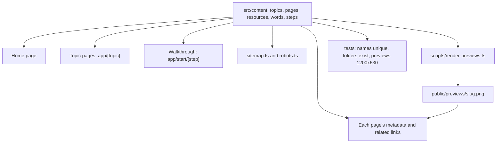
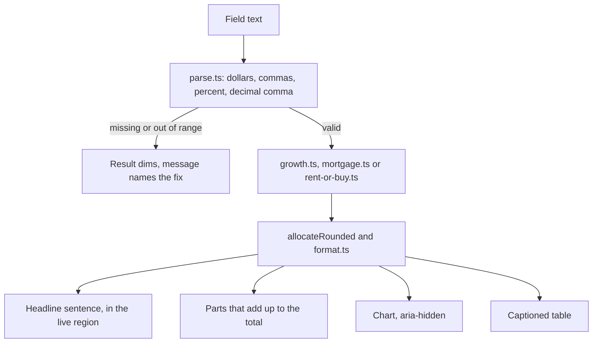

---

title: Personal Finance Site - Plan
type: feat
date: 2026-11-27
artifact_contract: ce-unified-plan/v1
product_contract_source: ce-plan-bootstrap
execution: code
---

# Personal Finance Site - Plan

The plan for `apps/personal-finance` (a working name, H1): a free site Hector can text to anyone, with explainers, tools and outside resources about personal finance, readable by someone with no money background at any age. Nothing is saved; everything runs in the browser. A path that starts with `app/`, `src/`, `tests/`, `docs/`, `scripts/` or `public/` is inside `apps/personal-finance/`. Other paths start at the repo root.

---

## Status

|                   |                                                                                                                                                                                     |
| ----------------- | ----------------------------------------------------------------------------------------------------------------------------------------------------------------------------------- |
| Phase             | Plan drafted 2026-11-27, nothing built. This file lands in Batch 1's pull request with U1, since a push of an app folder that has no `package.json` yet deploys every app on Vercel |
| Next              | U8, the style tiles, and U1, the app's shell: neither waits on the other                                                                                                            |
| Waiting on Hector | His read of this plan, and H1 to H6                                                                                                                                                 |
| Updated           | 2026-11-27                                                                                                                                                                          |

---

## How to read this plan

- Requirements (R) say what the site does. Each ends with where it came from: _asked_ is from Hector's request of 2026-11-27 or the scope he confirmed that day, and _gap_ is something Claude added because a reader arriving cold would need it. Any gap can be cut.
- Decisions (D) are product choices, and key technical decisions (KTD) are choices of mechanism. Each has its reason. A decision marked `session-settled` was put to Hector with its alternative on 2026-11-27 and he chose it.
- Needs from Hector (H) are calls only he can make. Each records his answer once he gives it.
- Units (U) are the build's steps. A batch is the units one pull request holds.

---

## Goal Capsule

- **Objective:** someone with no money background opens a link Hector texted them, on their phone, and understands that one idea well enough to use it, without Hector there to explain.
- **Means:** a fully static Next.js site in hector-mono, organized by topic with Hector's intro talk as the Start here walkthrough (D1, KTD1), with its pages, links and previews all built from one content list (KTD2).
- **Authority:** requirements win on behavior, and key technical decisions win on mechanism. The root `AGENTS.md` rules override this plan: never loosen a check, and nothing personal in the public repo.
- **Stop conditions:**
  - A shared check (Biome, Oxlint, Fallow, `tsc`) fails for a reason the code can't fix: stop and bring Hector the options. Never scope or loosen the rule.
  - A step would copy the words, layout or drawings of NYT's calculator, mortgagecalculator.org, Khan Academy or _Rich Dad Poor Dad_ onto the site: stop (D3).
  - A calculator disagrees with a worked example in `docs/finance-math.md`: fix the math or the example from its source, never the test's tolerance.
- **Who finishes:** Claude builds each batch in a worktree and opens its pull request. Hector merges, per the root `AGENTS.md`; this plan records no exception. Production steps (the Vercel project, the domain) wait for his OK at that moment.

---

## Product Contract

### Summary

A site of short pages, one idea each, grouped into topics, with Hector's talk as the front door. The first version has the talk as a click-through, three calculators (growth over time, a mortgage's true monthly cost, rent or buy), a glossary, a resources page, and topic pages that gather them. Each page has its own short link and link preview, because people will mostly get one link in a text.

### Problem frame

Hector keeps pointing people to the same handful of resources: his intro talk, a mortgage calculator, the New York Times' rent-or-buy calculator, and Khan Academy's course. Each assumes something the people he helps don't have. The talk works only with Hector in the room, since half of it lives in his speaker notes. The calculators expect the reader to know what PMI, a down payment or an investment return is. Khan's course is good but long.

The readers are friends and family of any age with no financial background. They open a texted link on a phone, read it once, and leave. A third of US adults score at the lowest level of numeracy (34% at Level 1 or below, [NCES PIAAC 2023](https://nces.ed.gov/surveys/piaac/2023/national_results.asp)), so numbers need more care than words. A page that shows a confident wrong number, or a number the reader can't connect to their own life, does harm.

### Words this plan uses

- **Page:** anything with its own link: a walkthrough, an explainer, a calculator, the glossary or the resources page.
- **Topic:** a group of pages and outside resources about one area of life, such as Housing.
- **Walkthrough:** the talk as a click-through. Each **step** is one idea with its own link.
- **Outside resource:** a link to someone else's material, with Hector's one-line note on why it's worth the time.
- **Preview:** the card a messaging app shows for a link: an image, a title and a line.
- **Example value:** the number a calculator field starts with, shown with its source and the date it was checked.

### Requirements

**Finding your way**

- R1. The home page opens with Start here, then one tile per topic. _asked_
- R2. A topic page lists its own pages first, then its outside resources, each with a one-line note on why it's worth reading. A topic with no pages of its own yet says so plainly and shows only its outside resources (Credit and Taxes, at first). _asked_
- R3. Every page has its own short link at the top level, such as `/mortgage`, and its own preview: the site's name, the page's title and one plain line on what the page does, with no urgency. _asked_
- R4. Every page makes sense to someone arriving cold. Its first lines say what it is, and it links to anything the reader should see first. _gap_
- R5. A mistyped or outdated link lands on a not-found page that lists every page. _gap_

**Start here**

- R6. The talk becomes a click-through of about 15 steps, one idea per step with no more than three things on screen. Each step has Back and Next, "Step 3 of 15" in words, swipe on a phone, and the arrow keys. _asked_
- R7. Each step has its own link, such as `/start/pay-yourself-first`, and works without Hector there: his speaker notes become the step's words. _asked_
- R8. The three growth steps are live. They open on the talk's numbers, and the reader can change them. Their numbers come from the same math as the growth calculator (R11), so the two never disagree. _asked_
- R9. Where a step touches a deeper page, it links to it, and the last step offers the topics. _asked_
- R10. The talk's assets-and-liabilities and cash-flow diagrams are redrawn in the site's own style, and the resources page credits the books they came from. _asked_

**Calculators**

- R11. **Growth over time:** a starting amount, a deposit monthly or yearly, how many years, optionally when the deposits stop, and a yearly return with quick picks of 4, 7 and 10%. It shows what you put in, what it grew to, and a chart and table by year. A switch shows the same in today's dollars, with an editable inflation rate. _asked_
- R12. **A mortgage's true monthly cost:** price, down payment in dollars or percent, rate, 15 or 30 years, property tax, home insurance, PMI, HOA and closing costs. It shows the monthly total split into its parts, the cash needed at closing, the total interest, when PMI ends, and how each year's payments split between interest and paying down the loan, as a chart and a table. _asked_
- R13. **Rent or buy:** the costs of buying, the costs of renting, and the return on money that isn't put into the house. It shows each path's net worth by year, how far ahead or behind buying leaves you after the years you'd stay, and the year buying pulls ahead for good. A what-if row shows the same answer if homes grow faster or slower. _asked_
- R14. Every result opens with one plain sentence that restates the main inputs, such as "For a $350,000 home with 10% down at 6.5%, you'd pay about $2,610 a month", then shows how that number is built from its parts. The parts shown add up to the total shown. _gap_
- R15. Every field has a visible label and unit, an example value with its source and the date it was checked, and a range. It accepts what people type: a dollar sign, commas, a percent sign, and a decimal comma. _gap_
- R16. While a field is empty or out of range, the result dims and a message names the fix, such as "Enter a price to see your payment". No result ever shows NaN, infinity, or a negative amount where none can exist. _gap_
- R17. Each calculator says in plain words what it leaves out and which rule it uses, and links to an outside tool for going further. _asked_
- R18. Before a page's code loads, and on a phone too old to run it, a calculator shows its example result and a note that the numbers change only in a newer browser. _gap_

**Words and resources**

- R19. A glossary gives every money term the site uses one plain definition. A term's first use on a page can be tapped to show its definition in place, and is a link to `/words` underneath, so it works before the page's code loads. _asked_
- R20. A resources page lists the outside material Hector points people to, each with his note and the date it was last checked: Khan Academy's Financial Literacy units, the books the talk cites, NYT's rent-or-buy calculator (labelled as possibly asking you to subscribe), mortgagecalculator.org, the CFPB's Loan Estimate explainer, and Investor.gov's compound interest calculator. Links open in the same tab. _asked_

**Every reader**

- R21. Phone first: every page works at 320px wide, and fields are at least 44px tall with 16px text, so an iPhone doesn't zoom in on them. Tap targets are at least 44px. _asked_
- R22. Body text is at least 18px, contrast meets WCAG 2.2 AA, and no meaning rests on color alone: chart lines are labelled and every chart has a table. Motion runs only when the reader hasn't asked for less. _asked_
- R23. Every control can be reached and used with a keyboard, and has a name a screen reader speaks. A step change moves focus to the new step's heading, and a recalculated result is announced once, politely. _gap_
- R24. Plain words: short sentences, one idea each, every term defined at its first use, money rounded to whole dollars. _asked_
- R25. Nothing is saved or sent. No accounts, no cookies, nothing typed is stored, and inputs never go into the link. The only tracking is page counts. The promise appears beside the first field of every calculator and in the footer. _asked_
- R26. Every footer says the site is for learning, not financial advice, and every result says it's an estimate. _gap_

### Success criteria

- Hector texts a page to someone with no money background. Afterwards, they can say in their own words what it showed them, such as what their monthly payment is made of. Hector runs this check with at least one person before the site is shared widely.
- Every page scores 100 for accessibility in Lighthouse.
- Every calculator reproduces the worked examples in `docs/finance-math.md`.

### Decisions

- D1. **Organized by topic, with the talk as Start here.** (session-settled: user-directed — chosen over a single guided path and over sorting pages by kind: people mostly get sent one thing, and a beginner doesn't know they need "a calculator".) Governs R1, R2, R9.
- D2. **One short, flat link per page.** (session-settled: user-approved — chosen over nesting pages under their topic, such as `/housing/mortgage`: a flat link survives a page moving topics and is easy to say aloud.) Governs R3, R7.
- D3. **The calculators and drawings are the site's own; outside tools are linked.** (session-settled: user-approved — chosen over embedding or copying NYT's calculator, mortgagecalculator.org or Khan Academy: their design and words are theirs, and Khan's material is licensed for non-commercial reuse only, per [its help article](https://support.khanacademy.org/hc/en-us/articles/202262954-Can-I-use-Khan-Academy-s-videos-name-materials-links-).) Governs R10, R17, R20.
- D4. **The talk is rewritten for someone reading alone.** (session-settled: user-approved — chosen over moving the slides across as they are: the slides lean on Hector talking.) Governs R6, R7, R8.
- D5. **Page counts only.** (session-settled: user-approved — chosen over no analytics at all: Hector can see what people open, and the counts hold no personal data.) Governs R25.
- D6. **US figures only.** PMI, property tax and the Loan Estimate are US rules, and Hector's readers are in the US. Governs R12, R13.
- D7. **The answer first, then how it's built.** Low numeracy is the bigger risk for these readers, so each result leads with a sentence and shows its parts. Governs R14, R16.

### Scope boundaries

Considered and not built, each with what would change the call:

- No accounts, saved scenarios or sync (D5). Nobody asked, and it would need a backend.
- No tax effects in rent or buy. Since 2018 most households take the standard deduction rather than deducting mortgage interest, and modelling taxes would need current IRS figures and a filing status. The page says taxes are left out (R17). Revisit if Hector wants it for readers who itemize.
- No redirects for mistyped links such as `/glossary` or `/rent-vs-buy`. The not-found page lists every page (R5). Revisit if the analytics show many 404s.
- No redirect for a walkthrough step that is later removed. Its old link reaches the not-found page and its list. Revisit if a step has to go after links to it have been sent.
- No fill-in budget tool. The budget step shows a worked example; a fourth calculator would bring all of R14 to R18 with it.
- No offline mode or service worker. The pages are static and small already.

#### Deferred to follow-up work

- Pages of the site's own for Credit and Taxes, and more topics.
- FHA, VA and USDA loans on `/mortgage`. FHA has its own insurance rules: 1.75% up front and about 0.5% a year under [HUD Mortgagee Letter 2023-05](https://www.hud.gov/sites/dfiles/OCHCO/documents/2023-05hsgml.pdf), which may have changed since.
- A link that carries a calculator's inputs, so Hector can send "this house at this rate". Vercel's page counts record the full link, query included, so this needs the query stripped from analytics first (R25).
- A preview image for each walkthrough step. Steps share the walkthrough's preview at first.

### Needs from Hector

- H1. **The name, the address and the links:** the site's name, its domain (the Vercel address until then), and the short link names this plan proposes: `/start` and its step names, `/compound-growth`, `/mortgage`, `/rent-or-buy`, `/words`, `/resources`, and `/basics`, `/saving`, `/investing`, `/housing`, `/credit` and `/taxes`. Links can't change once they've been texted, so they need checking before the first text.
- H2. **The mortgage site:** this plan assumes "the mortgage calculator website" is mortgagecalculator.org, and R12 covers what it covers.
- H3. **The look:** a round of style tiles in four directions, each built on one idea: jars and envelopes, receipt and pen, trail map, and poster. Also light only, or light and dark. This is a taste call.
- H4. **Hosting:** OK to make a Vercel project, `personal-finance`, before Batch 1's first push: Next.js preset, root `apps/personal-finance`, Skip deployment on, no variables. The domain is attached only after `main` has deployed (KTD14).
- H5. **The talk's third example:** it uses 11% a year, above the S&P 500's long-run compound average of 10.02% with dividends (1928 to 2025, [Damodaran, NYU Stern](https://pages.stern.nyu.edu/~adamodar/New_Home_Page/datafile/histretSP.html)). Keep 11%, use 10%, or show a range? Separately, the slide says $1,466,758, and the math that reproduces the other two examples exactly gives $1,466,784 (KTD8). The site shows $1,466,784 unless Hector finds the spreadsheet the slide came from.
- H6. **Copy review before Batch 1 merges:** the walkthrough's words, each outside resource's note, and the example values in KTD15. They go out under his name.

---

## Planning Contract

### Key technical decisions

- KTD1. **Next.js 16, fully static, with the portfolio's setup but not its files.** `cacheComponents`, `partialPrefetching`, `reactCompiler` and `ensureStatic = "navigation"` on the root layout, so the build fails if any page would render per request (`apps/hector-portfolio/next.config.ts`, `apps/hector-portfolio/app/layout.tsx`). The portfolio's own components can't be copied: it is the only app with `shadcn/no-arbitrary-values` off, and its `app/error.tsx` carries the repo's only app-level `biome-ignore`. Name the error page `ErrorPage`, as the other apps do. (session-settled: user-approved — chosen over Solid with plain Vite, like `apps/seating-chart`: a single-page app gives every texted link the same preview.) Governs R3, R18.
- KTD2. **One content module drives the site.** `src/content/` holds typed lists, written `as const satisfies` a type: topics, pages, outside resources, glossary terms and walkthrough steps. The home page, topic pages, sitemap, related links, previews and page metadata all read from it, so adding a page means one entry, its folder and its preview. Tests keep the list and the site from drifting apart (U2). Precedents: `SECTIONS` in `apps/job-search/app/_components/app-nav.tsx`, and `LINK_PREVIEWS` in `apps/community-game-library/app/_lib/link-previews.ts`.
- KTD3. **Pages are flat static folders, topics share one route.** Each page is its own folder (`app/mortgage/page.tsx`). Topics are `app/[topic]/page.tsx` with `generateStaticParams` from the topic list, and an unknown name calls `notFound()`. Flat folders avoid the path-reading layout failure in `docs/solutions/build-errors/layout-client-component-reading-the-path-fails-next-build.md`. A test checks that no page shares a topic's name.
- KTD4. **Prose is TSX over the content module, not MDX.** No app in the repo uses MDX. Its coverage by Biome, Oxlint and Fallow is unverified, and Next's docs say nothing about MDX under Cache Components. Explainer pages use a few shared prose components.
- KTD5. **Each page's preview is a committed 1200x630 PNG.** `next/og` styles only inline, and the design lint bans inline styles, raw colors and arbitrary values (`docs/solutions/developer-experience/next-og-images-ship-as-files-made-once.md`). One HTML template, `docs/preview-card.html`, draws a card from a title and a line. `scripts/render-previews.ts` loops over the content list and screenshots it with headless Chrome into `public/previews/<slug>-<PREVIEW_VERSION>.png`, as the portfolio renders its card (`apps/hector-portfolio/docs/seo.md`, "Share image"). The script runs outside the Claude Code sandbox and needs an `entry` line in `.fallowrc.json`. Each page's metadata names its own image, since a page that sets `openGraph` drops the inherited one. `PREVIEW_VERSION` is one constant in `src/site.ts` that `pageMetadata`, the script and the tests all read. It goes up whenever the card's template or the site's name changes, because some apps cache a preview by its address.
- KTD6. **One `SITE_URL` constant** in `src/site.ts` builds canonical links, `og:url`, image addresses, the sitemap and robots, as `apps/hector-portfolio/src/shared/config/site.ts` does. It starts as the Vercel production address and changes once, when H1 picks a domain.
- KTD7. **The money math is plain TypeScript in `src/finance/`.** No React imports; one test file per module in `tests/finance/`. `docs/finance-math.md` holds worked examples with their sources, and the tests assert the same numbers, following `apps/relationship-meter/docs/algorithm.md`. The schedule math stays unrounded, and rounding happens only for display. One `allocateRounded` helper rounds a total's parts so they add up to the rounded total (largest remainder, R14). Precedents: `apps/seating-chart/src/model/`, `apps/hectors-recipes/src/entities/scaling.ts`.
- KTD8. **Growth compounds yearly, with the talk's deposit rule.** A yearly deposit is made at the start of each year. A monthly deposit is made at the end of each month and earns simple interest until the year ends, and then the balance compounds. This reproduces the talk's first two examples to the cent ($122,345.87 and $157,435.17) and its third as $1,466,783.51, $25.51 above the slide (H5). A 0% return takes its own branch (deposits times periods), since the closed form divides by the rate. In today's dollars, each year's total is divided by `(1 + inflation)^year`, and each deposit by `(1 + inflation)` raised to the time it was made, so the amount put in counts each deposit at what it was worth when it went in. Deposits stay flat. At a 0% return the total then falls below what was put in, which is what inflation does to money that doesn't grow, and the sentence says so. Real monthly compounding would give about $1.72M for the third example, so the page states the rule (R17). One engine serves `/compound-growth` and the walkthrough (R8).
- KTD9. **The mortgage follows the standard monthly schedule.** Payment `L·i·(1+i)^n / ((1+i)^n − 1)` with `i` the yearly rate divided by 12, or `L/n` at 0%. No loan (100% down) means no principal, interest or PMI, and the page says the monthly cost is tax, insurance and HOA. A down payment above the price is an error. PMI applies when the down payment, in whole cents, is below 20% of the price rounded to the nearest cent. A down payment typed as a percent is turned into cents with the same rounding first. Comparing fractions fails: in floating point, 20% of $163,840.01 divided by the price comes out under 0.2. Monthly PMI is its yearly rate times the original loan, over 12. It ends at the first month whose scheduled balance is at or below 78% of the original price, or in the month after the loan's midpoint (month 181 of 360, month 91 of 180), whichever comes first, per the [CFPB](https://www.consumerfinance.gov/ask-cfpb/how-and-when-can-i-cancel-my-private-mortgage-insurance-pmi-en-202/). Both rules occur at real inputs: on a $300,000 home over 30 years, 5% down at 6.5% reaches 78% at month 135, while 0% down at 10% reaches the midpoint first. The end shows as "after 11 years and 3 months", since a date would need a start date and a clock read.
- KTD10. **Rent or buy is a yearly loop with tested parts.** Its shape is under High-level technical design. The rules that move the answer:
  1. Both paths start with the same cash: the down payment plus buying costs. The buyer spends it, and the renter invests it.
  2. Each year, whichever path costs less invests the difference at the investment return.
  3. Year one's buy cost is `/mortgage`'s monthly total for the same inputs, with tax, insurance, PMI and HOA taken from `mortgage.ts` in dollars, so one site never shows two prices for one house.
  4. From year two, property tax and insurance grow with the home's value at the start of each year, and maintenance is a percent of that value. HOA and renter's insurance rise with inflation, and rent rises with rent growth.
  5. The buyer's net worth in year t is what selling would leave that year: value, minus the loan balance, minus selling costs, plus the buyer's investments.
  6. The chart runs 30 years. Buying "pulls ahead for good" in the first year from which its net worth stays at or above renting's through year 30.
  7. The headline answers for the years you'd stay, from 1 to 30. If buying pulls ahead after that, it says so: "Not within 7 years. Buying pulls ahead in year 9."
  8. No taxes on either side (Scope boundaries). Every tax effect left out would help buying: the interest and property-tax deductions for people who itemize, and tax on the renter's investment gains, while most of a home's sale gain is tax-free. So the page says the answer leans toward renting, and why (R17).

  Before U7 fixes its example values, it reads NYT's methodology notes in the 2014 archive copy, which the research couldn't open.
- KTD11. **Walkthrough steps are static routes with stable names.** `app/start/[step]/page.tsx` has `generateStaticParams` from the step list, and `/start` renders the first step with its canonical link. Every step is real HTML that reads before the page's code loads and on old phones. A step read from `?step=` would show only a placeholder until the code loads, and numbered steps would point at different content once the talk changes. Step names are slugs and are never reused. Visited pages stay mounted but hidden in Next, so the route announcer can speak the page left behind. The app renders `<title>` from the layout shell, as job-search does (`docs/solutions/ui-bugs/route-announcer-speaks-the-page-left-behind-with-metadata-titles.md`), and a step change also moves focus to the new heading (R23). Swipes use recipes' rule (`apps/hectors-recipes/app/_lib/swipe.ts`: no swipe within 24px of an edge, at least 60px, one finger, mostly sideways). They're ignored when they start on a field, slider, chart or scrolling table, or while the reader is zoomed in. Arrow keys are ignored inside fields or with a modifier key held.
- KTD12. **Calculators are client components with fixed example inputs.** They prerender with their example values, so the static HTML already shows the example result (R18). Fields are `type="text" inputMode="decimal" autoComplete="off"`, outside any submitting form. One parser in `src/finance/parse.ts` accepts `$`, `%`, spaces and commas, and treats empty as missing, never 0. What a comma means depends on the field: in a dollar field it separates thousands, and in a percent field it's a decimal point, since a phone set to a comma-decimal language shows only a comma on its decimal keypad. So no field has to guess. Results recompute on every valid change. While a field is empty or out of range, the result keeps its height but hides its numbers, so no stale figure can be read (R16). A polite live region holds only the headline sentence, or the fix message while a field is invalid, updated on a short debounce. The state copies recipes' servings scaler, `apps/hectors-recipes/app/_components/recipe-servings.tsx`, minus its URL mirror (R25).
- KTD13. **Charts use `@repo/ui`'s `chart.tsx`, with recharts pinned to exactly `3.11.0`.** A second copy of recharts renders an empty chart with no error (`packages/ui/AGENTS.md`). This is the component's first use on a real page, so U3 records the calculator page's compressed JavaScript size in the app's `AGENTS.md`. Animation is off, since a calculator redraws on every keystroke. Each chart is `aria-hidden`, with a captioned table beside it as its equivalent, scrolling sideways inside a labelled region at 320px. Every chart also passes `accessibilityLayer={false}`: recharts 3.11 turns that layer on by default, which makes the chart's SVG a focus stop, and a focus stop inside an `aria-hidden` wrapper fails Lighthouse's check.
- KTD14. **Analytics and hosting follow the repo's lessons.** `<Analytics />` renders when `VERCEL_ENV` is set, and `VERCEL_ENV` is listed in `apps/personal-finance/turbo.json`. The portfolio's check on `VERCEL` works only because its `vercel.json` skips Turbo, and Turbo passes `VERCEL_ENV` by default. Web Analytics is turned on in the project's settings when the project is made (H4), since rendering `<Analytics />` alone records nothing. The project has Skip deployment on and no `ignoreCommand` (`docs/solutions/developer-experience/vercel-counts-builds-an-ignore-command-cancels.md`). A new project's first branch push has gone to production twice, so the domain is attached only after `main` deploys (`docs/solutions/developer-experience/new-vercel-projects-first-deployment-went-to-production-from-a-branch.md`).
- KTD15. **Example values live in one file with their sources.** `src/finance/assumptions.ts` gives each example value, its source link and an as-of date written as a constant, so nothing reads the clock while prerendering. The table below is the starting set. Values marked _judgment_ have no primary source and are shown as examples to change. U6 and U7 confirm or replace them.

  | Value                                  | Example                    | Source                                                                                                                                                          |
  | -------------------------------------- | -------------------------- | --------------------------------------------------------------------------------------------------------------------------------------------------------------- |
  | Growth: yearly return                  | 7% (quick picks 4, 7, 10%) | _judgment_, below the S&P 500's 10.02% compound average 1928 to 2025 ([Damodaran](https://pages.stern.nyu.edu/~adamodar/New_Home_Page/datafile/histretSP.html)) |
  | Growth and rent or buy: inflation      | 3%                         | _judgment_                                                                                                                                                      |
  | Mortgage: rate                         | Looked up in U6            | [Freddie Mac's weekly survey](https://www.freddiemac.com/pmms), with the week it was checked                                                                    |
  | Mortgage: property tax                 | 0.9% of the price a year   | National average of 0.89% in 2024, [NAHB](https://eyeonhousing.org/2025/11/property-taxes-by-state-2024/)                                                       |
  | Mortgage: home insurance               | Confirmed in U6            | No primary source found yet; Bankrate's August 2025 average was $2,470 a year                                                                                   |
  | Mortgage: PMI                          | 0.7% of the loan a year    | _judgment_, inside the 0.46% to 1.5% range Experian cites from the Urban Institute                                                                              |
  | Mortgage: closing costs                | 3% of the price            | _judgment_, inside the 2% to 5% industry range                                                                                                                  |
  | Rent or buy: years you'd stay          | 7                          | _judgment_                                                                                                                                                      |
  | Rent or buy: home and rent growth      | 3% each                    | _judgment_, confirmed against NYT's notes in U7                                                                                                                 |
  | Rent or buy: investment return         | 6%                         | _judgment_, a mixed portfolio below the stock-only average                                                                                                      |
  | Rent or buy: maintenance, selling cost | 1% of value a year; 6%     | _judgment_; the 2007 NYT calculator used 6% for selling                                                                                                         |

- KTD16. **The look is one theme file, and fields grow through a shared size.** `packages/ui/src/styles/themes/personal-finance.css` comes from the Design System Hector picks (H3). It's one file, and the theme test finds it unaided, as in seating-chart's commit `2d50106`. Until then the app uses the default theme. The shared `Input` is 32px tall with no size variant, and `no-restyle` refuses a height class. So U3 adds a size to `packages/ui/src/components/input.tsx` for 44px fields with 16px text, and lists it in `packages/ui/AGENTS.md`'s re-apply list. A theme or `packages/ui` change deploys every app, so it ships inside a batch. Fonts come from `next/font/google`, like the other Next apps. That means `next build` fetches them and runs outside the sandbox.

### High-level technical design

How the content module drives the site (KTD2, KTD3, KTD5):



How a calculator turns typing into a result (KTD7, KTD12):



The rent-or-buy loop (KTD10), as directional pseudo-code:

```text
cash = down payment + buying costs
renter.invested = cash ; buyer.invested = 0
for year in 1..30:
  start  = price × (1 + home growth)^(year − 1)        the home's value as the year begins
  buy    = this year's mortgage payments and PMI (from mortgage.ts)
         + tax and insurance: year one's dollars from mortgage.ts, then growing with start
         + maintenance % × start
         + HOA, rising with inflation
  rent   = rent × (1 + rent growth)^(year − 1) × 12
         + renter's insurance, rising with inflation
  the cheaper path adds |buy − rent| to its own investments
  both investment pots grow at the investment return
  end    = price × (1 + home growth)^year
  buyer.netWorth  = end − loan balance − selling cost % × end + buyer.invested
  renter.netWorth = renter.invested
headline: compare the two in the year you'd sell
pulls ahead for good: first year buyer ≥ renter through year 30
```

### Output structure

```text
apps/personal-finance/
  AGENTS.md
  package.json  next.config.ts  tsconfig.json  components.json
  postcss.config.mjs  bunfig.toml  turbo.json
  docs/
    build-plan.md        this plan
    finance-math.md      worked examples the tests assert
    preview-card.html    the template the previews are drawn from
  app/
    layout.tsx  globals.css  page.tsx  not-found.tsx  error.tsx
    sitemap.ts  robots.ts
    [topic]/page.tsx
    start/page.tsx  start/[step]/page.tsx
    compound-growth/  mortgage/  rent-or-buy/  words/  resources/
    _components/         header, footer, page title, word, calculator parts, walkthrough
  src/
    site.ts  seo.ts
    content/             topics, pages, resources, words, steps
    finance/             parse, format, growth, mortgage, rent-or-buy, assumptions
    lib/swipe.ts
  scripts/render-previews.ts
  public/previews/       one PNG per page
  tests/                 content/, finance/, seo, previews, swipe, screens
```

### System-wide impact and risks

- **Root files deploy every app.** U1 and U2 change `.oxlintrc.json`, `.fallowrc.json`, `.claude/launch.json`, the root `AGENTS.md` and `README.md`. A push that touches any of them builds every Vercel project, so they ship in Batch 1's one push.
- **`packages/ui` changes reach every app.** U3's field size and U9's theme run every app's checks (`...@repo/ui`) and deploy every app. The field size goes on `packages/ui/AGENTS.md`'s re-apply list, so a shadcn overwrite of `input.tsx` doesn't silently drop it.
- **recharts on a real page for the first time.** A second copy renders an empty chart with no error, so the app pins `3.11.0` exactly, and U3 measures what the chart adds to the page (KTD13).
- **NYT's methodology is unread.** U7's first step reads it before the example values are fixed (KTD10).
- **Example values go stale,** the mortgage rate most of all. Each one shows its as-of date beside it (R15, KTD15), so a reader can see its age.
- **Some failures show only in `next build`,** such as a clock read or a path read while prerendering, and CI doesn't build. Every unit runs the build (Verification Contract).
- **Phones older than Safari 16.4,** Next 16's floor, get the static pages without their code. R18 covers what a calculator shows them.

### Sequencing

- **Batch 1** (the first pull request): U1 to U5. That covers the shell, the content list and its pages, the growth calculator, the walkthrough, and the glossary and resources. This plan file goes in with it.
- **Batch 2:** U6 and U7, the mortgage and rent or buy.
- **The look runs beside them:** U8 makes the style tiles, which wait for nothing. U9 applies the chosen theme and ships in whichever batch is open when Hector picks (H3).

---

## Implementation Units

### U1. The app's shell

- **Goal:** a new static Next.js app that builds, lints and deploys, with the layout every page shares.
- **Requirements:** R5, R21, R22, R25, R26. KTD1, KTD6, KTD14, KTD16.
- **Dependencies:** none.
- **Files:**
  - Create: `package.json` (first, with `bun install`, so the lint hook finds it), `next.config.ts`, `tsconfig.json`, `components.json`, `postcss.config.mjs`, `bunfig.toml`, `turbo.json`, `AGENTS.md`
  - Create: `app/layout.tsx`, `app/globals.css`, `app/not-found.tsx`, `app/error.tsx`, `app/robots.ts`, `app/sitemap.ts`, `app/_components/site-header.tsx`, `app/_components/site-footer.tsx`, `app/_components/page-title.tsx`
  - Create: `src/site.ts`, `src/seo.ts`
  - Modify: `.claude/launch.json` (`personal-finance` on 3104, `personal-finance-prod` on 3207), `.oxlintrc.json` (add the app to the design-rules entry), `AGENTS.md` (Monorepo Structure and the simple-apps list), `README.md` (the app table)
  - Test: `tests/seo.test.ts`
- **Approach:**
  1. Follow `.claude/skills/new-app/SKILL.md` step by step, taking versions from `apps/hector-portfolio/package.json`.
  2. Set up the root layout per KTD1, with `lang="en"`, a skip link, the footer's learning-not-advice line and the nothing-saved line (R25, R26).
  3. Render `<title>` from the shell (KTD11). `page-title.tsx` reads `usePathname()` inside `<Suspense>` and names the page from the content list. The layouts' metadata sets no title, and each page's metadata sets `openGraph.title` for its preview.
  4. Make `src/seo.ts`'s `pageMetadata` give each page its canonical link, `og:url` and its own preview image (KTD5, KTD6).
  5. Make the not-found page list every page from the content list once U2 exists. Until then, it links home.
  6. Put the site's name in the header, linking home, with links to the topics on the home page and to `/words`. The header stays at the top of the screen and fits on one line at 320px, so a reader who lands deep from a text can always get to the rest of the site.
- **Patterns to follow:** `apps/hector-portfolio/app/layout.tsx` and `src/shared/utils/seo.ts` (structure only, KTD1), `TabTitle` in `apps/job-search/app/_components/app-nav.tsx` for the title in the shell, `apps/community-game-library/app/error.tsx` for `ErrorPage`.
- **Test scenarios:**
  - `pageMetadata({ path: "/mortgage" })` returns `${SITE_URL}/mortgage` as both the canonical link and `og:url`.
  - `pageMetadata` for `/mortgage` names `/previews/mortgage-<PREVIEW_VERSION>.png` as its image, at 1200x630.
  - The root layout's metadata has no canonical link or `og:url`, so the 404 page doesn't claim the home page's address.
- **Verification:** `bun run build --filter=personal-finance` (outside the sandbox) prints every route as static, and the app's checks and `bun run dead-code` pass. In the browser pane at 375px, the empty home page shows the header, footer and skip link.

### U2. The content list and the pages it drives

- **Goal:** topics, pages and outside resources as one typed list, with the home page, topic pages, sitemap and previews built from it.
- **Requirements:** R1, R2, R3, R4, R5. D1, D2. KTD2, KTD3, KTD5.
- **Dependencies:** U1.
- **Files:**
  - Create: `src/content/topics.ts`, `src/content/pages.ts`, `src/content/resources.ts`
  - Create: `app/page.tsx`, `app/[topic]/page.tsx`, `app/_components/topic-tile.tsx`, `app/_components/related-pages.tsx`, `app/_components/read-first.tsx`
  - Create: `docs/preview-card.html`, `scripts/render-previews.ts`, `public/previews/*.png`
  - Modify: `app/sitemap.ts`, `app/not-found.tsx`, `.fallowrc.json` (an `entry` for the script)
  - Test: `tests/content/content.test.ts`, `tests/previews.test.ts`
- **Approach:**
  - A page entry has its slug, title, one-line summary, topic, kind (`walkthrough`, `explainer`, `calculator`, `glossary` or `resources`), what to read first, and sources.
  - A resource entry has its title, link, publisher, Hector's note, the topic or topics it belongs to, and the date it was last checked.
  - Topics: `basics`, `saving`, `investing`, `housing`, `credit` and `taxes`, the last two with resources only (R2). Khan's units are linked one by one, under the topics they fit.
  - A page's first lines come from its summary, and its "read first" links from its entry (R4).
  - The preview card shows the site's name, the title and the summary, with no urgency (R3). Its copy follows R24.
- **Patterns to follow:** `apps/community-game-library/tests/app/link-previews.test.ts` for reading a PNG's size, and `apps/hector-portfolio/app/sitemap.ts`.
- **Test scenarios:**
  - No two topics or pages share a slug.
  - Every page in the list has a folder with `page.tsx` under `app/`, except those the walkthrough route serves.
  - Every page in the list has `public/previews/<slug>-<PREVIEW_VERSION>.png` at exactly 1200 by 630.
  - Every page's topic exists, and every "read first" slug names a real page.
  - Every resource link is `https`, and every resource has a checked date and a note.
  - A topic with no pages of its own (Credit) is still listed, and its page says it has outside resources only.
  - The sitemap lists every page and topic once, at an absolute address.
- **Verification:** at 375px, the home page shows Start here and six topic tiles. Until U6 adds `/mortgage`, `/housing` says it has outside resources only so far and lists them. `/nope` shows the not-found page and its list. Each page's HTML has an absolute `og:image` and `og:url`.

### U3. Growth over time

- **Goal:** the growth math, the shared calculator parts, and `/compound-growth`.
- **Requirements:** R8, R11, R14, R15, R16, R17, R18, R21, R23, R25, R26. KTD7, KTD8, KTD12, KTD13, KTD15, KTD16.
- **Dependencies:** U1, U2.
- **Files:**
  - Create: `src/finance/parse.ts`, `src/finance/format.ts`, `src/finance/growth.ts`, `src/finance/assumptions.ts`, `docs/finance-math.md`
  - Create: `app/compound-growth/page.tsx`, `app/_components/calculator/money-field.tsx`, `app/_components/calculator/result-sentence.tsx`, `app/_components/calculator/chart-and-table.tsx`, `app/_components/calculator/old-browser-note.tsx`
  - Modify: `packages/ui/src/components/input.tsx` and `packages/ui/AGENTS.md` (the field size, KTD16)
  - Test: `tests/finance/parse.test.ts`, `tests/finance/format.test.ts`, `tests/finance/growth.test.ts`, `tests/screens/calculator.test.tsx`
- **Approach:**
  - `growth.ts` returns a year-by-year series and its totals, and the walkthrough calls it as well (R8).
  - The shared calculator parts serve U6 and U7 too: a field with its unit, example and range; the headline sentence in its live region; a chart beside its captioned table; and the note shown until the page's code loads (R18).
  - A field's label, unit and range sit with it, and its example's source and as-of date sit on one line under it.
  - At phone width a calculator reads in this order: the headline sentence, the fields, the parts, the chart and the table. U6 and U7 use the same order, unless the tile Hector picks in U8 places the result differently.
  - A field's unit sits beside the input as plain text, not in an `InputGroup` addon, whose own fixed height would need a second change to `packages/ui` (KTD16).
  - Screen tests follow job-search's `test:screens` setup (`apps/job-search/tests/_support/dom.ts`).
- **Execution note:** write `docs/finance-math.md`'s worked examples and their tests before the math.
- **Patterns to follow:** `apps/hectors-recipes/src/entities/scaling.ts` and `app/_components/recipe-servings.tsx`, `apps/relationship-meter/docs/algorithm.md`.
- **Test scenarios:**
  - $1,000 a year for 30 years at 8%, from nothing, comes to $122,345.87.
  - $1,000 a year for 10 years at 8%, then no deposits until year 40, comes to $157,435.17.
  - $200 a month for 40 years at 11% comes to $1,466,783.51 (H5 records the slide's $1,466,758).
  - At 0%, $100 a month for 10 years comes to exactly $12,000, with no NaN.
  - Years 0 returns the starting amount.
  - $1,000 a year for 30 years, at the start of each year, with 3% inflation shows about $20,188 put in, in today's dollars.
  - At a 0% return and 3% inflation, the total in today's dollars is below the amount put in, and the sentence names inflation as the reason.
  - In a dollar field, `$350,000` reads as 350000 and `1,234` as 1234. In a percent field, `6,5` reads as 6.5 and `6.5%` as 6.5. Empty is missing, never 0. `abc`, `1e3` and `0x10` are invalid.
  - A rate above 25%, more than 80 years, or an amount above $100M is out of range, and the message names the range.
  - `allocateRounded` turns parts of 1,210.45, 300.40 and 99.30 into 1,211, 300 and 99, which add up to the rounded total of 1,610. Rounding each part on its own would give 1,609.
  - `format` never prints NaN, infinity or `-$0`.
  - Screen: clearing the deposit field hides the result's numbers, keeps its height, and puts "Enter a deposit to see what it grows to" in the live region. Typing a deposit back brings the result back.
  - Screen: the live region holds only the headline sentence or the fix message, and it changes once per settled edit.
  - Screen: the chart's container holds no element that takes focus.
- **Verification:** at 375px, `/compound-growth` shows the example result before the page's code runs (checked on `next start` with a throttled network). Typing 6,5 into the return field reads as 6.5%. The fields measure at least 44px tall with 16px text. The app's `AGENTS.md` records the page's compressed JavaScript size (KTD13).

### U4. Start here: the walkthrough

- **Goal:** the talk as about 15 static steps, each with its own link.
- **Requirements:** R6, R7, R8, R9, R10, R23, R24. D4. KTD11.
- **Dependencies:** U2, U3.
- **Files:**
  - Create: `src/content/steps.ts`, `src/lib/swipe.ts`
  - Create: `app/start/page.tsx`, `app/start/[step]/page.tsx`, `app/_components/walkthrough/step-view.tsx`, `app/_components/walkthrough/step-nav.tsx`, `app/_components/walkthrough/growth-example.tsx`, `app/_components/walkthrough/assets-and-liabilities.tsx`, `app/_components/walkthrough/cash-flow.tsx`
  - Test: `tests/content/steps.test.ts`, `tests/swipe.test.ts`
- **Approach:**
  - The steps follow the talk, as Hector's review settles them (H6). Proposed: why money matters, start with goals, where your money goes (income and expenses), what you own and owe (assets and liabilities), the work-and-spend loop, the lazy way out, starting late, starting early, a little every month, money that makes money, assets put money in your pocket, where to start, know where it goes (a budget), pay yourself first, and where to next.
  - The three growth steps use `growth-example.tsx` over `growth.ts`, opening on the talk's numbers (R8, H5). Their words quote the live result rather than a fixed figure, so changed inputs can't leave the prose stale.
  - Each growth step offers one field, the deposit, and gives the result as a sentence. The chart and the other fields stay on `/compound-growth`, which the step links to, so a step keeps to three things on screen (R6).
  - The diagrams are SVG components styled with theme classes and SVG attributes, since `no-inline-styles` bans style objects, and each has a `<title>` (R10).
  - Back is a link to the previous step, Next a link to the next, and the first step has no Back. On the last step, Next becomes the topic tiles (R9).
  - On each step change, focus moves to the heading (`tabIndex={-1}`) and the page scrolls to the top (R23).
  - Swipes and arrow keys follow KTD11. Their listeners belong to the visible step only, since Next keeps visited pages mounted but hidden.
- **Patterns to follow:** `apps/hectors-recipes/app/_lib/swipe.ts`, `use-swipe.ts` and its Playwright touch flows (`tests/flows/touch.ts`).
- **Test scenarios:**
  - Step slugs are unique, and each step has a title, words and at most three blocks.
  - `/start` and `/start/<first slug>` render the same step, and the canonical link of both is `/start`.
  - An unknown step name returns the not-found page.
  - `swipeDirection` ignores a swipe starting within 24px of either edge, one shorter than 60px, one more vertical than 1.5 times its sideways run, and a two-finger move.
  - A swipe that starts on a field, slider or chart doesn't change the step.
  - An arrow key pressed inside a field, or with Alt held, doesn't change the step.
  - The "starting late" step with its example inputs shows $122,346, and after the deposit changes to $2,000, $244,692.
- **Verification:** at 375px, every step reads with JavaScript off. With JavaScript on, Next, Back, a swipe and the arrow keys move one step each, and the browser's own Back returns to the previous step. After a step change, `document.title` and the focused element are the new step's. Arrow keys pressed on `/compound-growth` after visiting `/start` do nothing.

### U5. Words and resources

- **Goal:** the glossary with in-place definitions, and the resources page.
- **Requirements:** R19, R20, R24. D3.
- **Dependencies:** U2.
- **Files:**
  - Create: `src/content/words.ts`, `app/words/page.tsx`, `app/resources/page.tsx`, `app/_components/word.tsx`
  - Test: `tests/content/words.test.ts`
- **Approach:**
  - A term is marked by hand, at its first use on a page or step, as `<Word slug="pmi">PMI</Word>`. The slug's type comes from the glossary's keys, so a missing term fails the typecheck.
  - `word.tsx` renders a link to `/words#<slug>`, and once the page's code loads, a tap opens `@repo/ui`'s Popover in place. Popover, not Tooltip, because a tooltip needs hover.
  - Rules for marking terms: never inside a link, button, chart, table header or `<label>`, where the marker sits beside the label instead (`docs/solutions/test-failures/base-ui-control-inside-its-label-flips-twice-in-happy-dom.md`); no popover inside another; and any open popover closes on a step change.
  - The resources page groups resources by topic. Each resource shows Hector's note and its checked date, and NYT's says it may ask you to subscribe.
- **Test scenarios:**
  - Every term has a definition of no more than two sentences, and no two terms share a slug.
  - Every term the site marks appears on `/words` with an anchor whose name is its slug.
  - The resources page lists every resource in `resources.ts` exactly once per topic it belongs to.
- **Verification:** with JavaScript off, a marked term is a working link to its anchor on `/words`. With it on, a tap shows the definition and Escape closes it. The anchors sit clear of the sticky header.

### U6. A mortgage's true monthly cost

- **Goal:** the mortgage math and `/mortgage`.
- **Requirements:** R12, R14 to R18, D6, D7. KTD9, KTD15.
- **Dependencies:** U3.
- **Files:**
  - Create: `src/finance/mortgage.ts`, `app/mortgage/page.tsx`, `app/_components/calculator/payment-parts.tsx`
  - Modify: `src/finance/assumptions.ts`, `docs/finance-math.md`, `src/content/pages.ts`, and a preview for `/mortgage` in `public/previews/`
  - Test: `tests/finance/mortgage.test.ts`
- **Approach:**
  - The fields follow mortgagecalculator.org's coverage without its design (H2, D3). Each field shows its unit beside it.
  - The down payment and the tax take dollars or a percent. Switching converts the value rather than keeping the typed number.
  - Insurance is dollars a year, HOA dollars a month, PMI a percent a year of the original loan, and closing costs a percent of the price.
  - The results follow page 1 of the CFPB's [Loan Estimate](https://www.consumerfinance.gov/owning-a-home/loan-estimate/), and the page links to it as the number a lender will actually give.
  - Before the example values are fixed, look up the rate (KTD15).
- **Execution note:** write the worked examples in `docs/finance-math.md` and their tests before the math.
- **Test scenarios:**
  - A $300,000 loan at 6.5% over 30 years pays $1,896.20 a month in principal and interest.
  - At 0%, a $360,000 loan over 30 years pays exactly $1,000 a month.
  - With 100% down, principal, interest and PMI are $0, and the sentence names tax, insurance and HOA as the monthly cost.
  - A down payment above the price is invalid, with a message, and never a negative loan.
  - On a $163,840.01 price: 20% typed as a percent charges no PMI, $32,768.00 typed in dollars (20% to the cent) charges none, and $32,767.99 charges PMI.
  - $300,000 at 6.5% over 30 years with 5% down: PMI ends at month 135, when the balance reaches 78% of the original price.
  - $300,000 at 10% over 30 years with 0% down: PMI ends at month 181, the month after the midpoint, before the balance reaches 78%.
  - $300,000 at 7% over 15 years with 10% down: PMI ends at month 38 by the 78% rule, well before month 91.
  - The monthly parts shown add up to the total shown.
  - Total interest equals the sum of the schedule's interest, to the cent.
- **Verification:** at 375px, the true monthly cost, its parts, the cash at closing and the PMI end appear, and switching the down payment between dollars and percent keeps the same amount. `/housing` now lists `/mortgage`, then its resources.

### U7. Rent or buy

- **Goal:** the rent-or-buy loop and `/rent-or-buy`.
- **Requirements:** R13 to R18, D6, D7. KTD10, KTD15.
- **Dependencies:** U6.
- **Files:**
  - Create: `src/finance/rent-or-buy.ts`, `app/rent-or-buy/page.tsx`
  - Modify: `src/finance/assumptions.ts`, `docs/finance-math.md`, `src/content/pages.ts`, and a preview for `/rent-or-buy` in `public/previews/`
  - Test: `tests/finance/rent-or-buy.test.ts`
- **Approach:**
  1. Read NYT's methodology notes in the [2014 archive copy](https://webarchive.library.unt.edu/web/20141029230532/http://www.nytimes.com/interactive/2014/upshot/buy-rent-calculator.html). Record in `docs/finance-math.md` where this model differs and why.
  2. Fix the example values in `assumptions.ts`.
  3. Build `rent-or-buy.ts` as KTD10's loop, with each year's buy cost drawn from `mortgage.ts`.
  4. Build the page: the headline for the years you'd stay, then the pulls-ahead year, then the chart with that year marked and the what-if row for home growth at 1%, 3% and 5%.
  5. Show five fields to everyone: the price, the down payment, the rate, the monthly rent and the years you'd stay (1 to 30). The rest sit in a "Change the assumptions" group, closed at first, each with its label, unit, example and source as R15 asks.
  6. Describe the buyer's result as what selling would leave you, without calling the home an asset or a liability, since the talk may use "asset" in another sense.
- **Execution note:** a worked seven-year example goes in `docs/finance-math.md` first, with every year's figures, and the tests assert its intermediate years.
- **Test scenarios:**
  - The seven-year worked example matches every year's two net worths to the dollar.
  - In year t, the buyer's net worth subtracts selling costs on that year's value.
  - When buying costs more in a year, the renter's investments grow by the difference, and the reverse holds when renting costs more.
  - Year one's buy cost matches `/mortgage`'s full monthly total for the same inputs, tax, insurance, PMI and HOA included.
  - A 15-year loan over a 20-year stay: in years 16 to 20 the buy cost is tax, insurance, maintenance and HOA only.
  - A stay of 0 or more than 30 years is out of range, and the message names the range.
  - When buying never catches up within 30 years, the result says so and shows no pulls-ahead year.
  - When buying is ahead from year 1 and stays there, the pulls-ahead year is 1.
  - When the lines cross twice, the pulls-ahead year is the later crossing, after which buying stays ahead.
- **Verification:** at 375px, the headline and the pulls-ahead year read without the chart. Changing home growth moves the what-if row, and the page says taxes are left out.

### U8. The style tiles

- **Goal:** a round of style tiles in four single-idea directions, for Hector to pick from (H3).
- **Requirements:** R21, R22, D7.
- **Dependencies:** none.
- **Files:** none in the repo. A private Claude Design canvas, linked from the app's `AGENTS.md` once picked.
- **Approach:**
  - Each tile builds the same three things in its direction (jars and envelopes, receipt and pen, trail map, poster): a step of the walkthrough, the mortgage calculator at 375px with its result, and a preview card. The calculator shows where the result sits while a field is being edited.
  - Each direction has one idea of its own that explains every component. None is a hybrid of the others.
  - Every tile holds to R21 and R22: 18px body text, AA contrast, 44px fields with 16px text, and charts that don't rely on color alone.
  - Each tile shows light, and dark if H3 asks for it. No direction is presented as Claude's pick.
- **Test expectation:** none, since this is design work outside the repo.
- **Verification:** Hector picks a direction, or asks for another round.

### U9. The chosen theme

- **Goal:** the picked direction as the app's theme, with the previews drawn in it.
- **Requirements:** R21, R22. KTD5, KTD16.
- **Dependencies:** U8 and H3. It lands in the open batch.
- **Files:**
  - Create: `packages/ui/src/styles/themes/personal-finance.css`
  - Modify: `app/globals.css`, `app/layout.tsx` (`data-theme`), `docs/preview-card.html`, `public/previews/*.png`, `AGENTS.md`
- **Approach:**
  1. Generate the theme from the Design System rather than hand-picking values, as `recipes.css` is.
  2. A light-only theme repeats its light values in the dark block, so the theme test passes.
  3. The direction's own touches are data attributes the theme styles (`data-color`, `data-ink` in `community-game-library.css`), since the design lint reports app-defined classes.
  4. Re-render every preview in the new look and raise `PREVIEW_VERSION` (KTD5).
- **Test scenarios:**
  - `packages/ui/tests/src/styles/themes.test.ts` passes with the new file.
- **Verification:** the `@repo/ui` checks pass for every app. `bun run dead-code` reports no CSS drift. In the browser pane, every page's contrast passes and fields stay at 44px or more.

---

## Verification Contract

| Check              | Command or method                                                                                                                                                          | When                         |
| ------------------ | -------------------------------------------------------------------------------------------------------------------------------------------------------------------------- | ---------------------------- |
| Lint and types     | `bun check --filter=personal-finance && bun ts --filter=personal-finance`                                                                                                  | Every unit                   |
| Tests              | `cd apps/personal-finance && bun test`, and `bun run test:screens` from U3                                                                                                 | Every unit with tests        |
| Dead code          | `bun run dead-code`                                                                                                                                                        | Every unit                   |
| Static build       | `bun run build --filter=personal-finance`, outside the sandbox (fonts): every route static                                                                                 | Every unit; CI doesn't build |
| Shared UI          | `bun check --filter=...@repo/ui && bun ts --filter=...@repo/ui && bun run test --filter=...@repo/ui`                                                                       | U3 (the field size), U9      |
| Phone and keyboard | The browser pane at 375px on `personal-finance` (3104) and `personal-finance-prod` (3207): keyboard only, reduced motion, and a deep link to a step on a throttled network | Every page unit              |
| Accessibility      | Lighthouse accessibility at 100 for each page, run locally as the portfolio's `lighthouse` script does                                                                     | End of each batch            |
| Previews           | Each page's HTML has an absolute `og:image` and `og:url`. After `main` deploys, a link texted in iMessage shows its card (Hector)                                          | End of each batch            |
| Outside links      | Open each link in `resources.ts` and update its checked date                                                                                                               | End of each batch            |
| Analytics          | After `main` deploys, a production page view shows in the project's Analytics tab                                                                                          | End of Batch 1               |
| Reader check       | Hector texts `/start` or `/compound-growth` to someone with no money background and notes what they could and couldn't say back. Status records it                         | End of Batch 1, before U6    |

---

## Definition of Done

- Every requirement a batch covers is true and checked as above, and every check in the Verification Contract passes.
- The app's `AGENTS.md` describes what was built, with its patterns and gotchas, and this plan's Status says where things stand.
- No code from abandoned approaches is left in the diff.
- Each pull request carries its lessons in `docs/solutions/`, written with `ce-compound`, or says none qualified.
- Batch 1 has Hector's copy review (H6) before it merges.
- Batch 1's reader check is in Status before U6 starts, and any change it calls for in the shared calculator parts lands first, so U6 and U7 build on the corrected parts.
